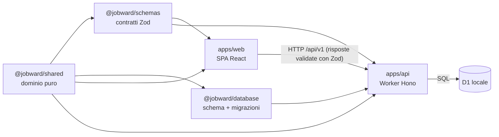

# Impatto delle modifiche

**Stato:** canonico · **Verificato su:** `jobward-v1` `b34c032` (2026-11-22, PID-01). Per ogni sottosistema: chi ne dipende, quali test lo proteggono, quali invarianti non si rompono e quali documenti aggiornare nello stesso commit. Dove si trovano i file: [REPOSITORY-MAP](REPOSITORY-MAP.md). Regola generale di aggiornamento: [WORKFLOW](../agents/WORKFLOW.md#aggiornamento-della-documentazione).

Abbreviazioni: `W` = `apps/web/src`, `A` = `apps/api/src`, `S` = `packages/shared/src`, `Z` = `packages/schemas/src`, `D` = `packages/database`, `T` = `apps/api/test`, `E` = `apps/web/e2e`.

Un cambiamento in `@jobward/shared` può toccare **tutto**; uno in `apps/web` non tocca mai l'API.

## Sottosistemi

| Sottosistema                 | Codice                                                                                                                                                                   | Dipendono da lui                                                                                     | Test che lo proteggono                                                                                                             | Invarianti da non rompere                                                                                                                                                                                                                                                | Documenti da aggiornare                                                                                                                                                            |
| ---------------------------- | ------------------------------------------------------------------------------------------------------------------------------------------------------------------------ | ---------------------------------------------------------------------------------------------------- | ---------------------------------------------------------------------------------------------------------------------------------- | ------------------------------------------------------------------------------------------------------------------------------------------------------------------------------------------------------------------------------------------------------------------------ | ---------------------------------------------------------------------------------------------------------------------------------------------------------------------------------- |
| **Vocabolari e costanti**    | `S/constants.ts`, `S/errors.ts`                                                                                                                                          | `CHECK` del database, schemi Zod, UI (etichette), limiti dei servizi                                 | `T/database.test.ts`, `pnpm db:check`, test di `S/`                                                                                | I `CHECK` SQL derivano dalle costanti TS: cambiare un valore richiede una migrazione                                                                                                                                                                                     | [DATA-MODEL](DATA-MODEL.md), [DOMAIN-GLOSSARY](../product/DOMAIN-GLOSSARY.md)                                                                                                      |
| **Pipeline e candidature**   | `S/pipeline*.ts`, `A/services/pipeline.ts`, `A/services/applications.ts`, `W/features/pipeline*/`, `W/features/applications/`                                            | Overview, Opportunità, Insights, Calendario, Ricerca, Aziende (tutti leggono `current_applications`) | `T/pipeline`, `T/applications`, test di `S/pipeline-transitions`, `E/workflow`, `E/product-v1`, `W/pipeline-board/columns.test.ts` | Fase/esito/data d'invio solo in `applications`; scritture solo da pipeline e nuova candidatura; `PATCH /cards/:id` non scrive stato; confronto e scambio + `dedupe_key`; nessuna transizione da/verso `archived`                                                         | [WORKFLOWS](../features/WORKFLOWS.md), [APPLICATIONS](../features/APPLICATIONS.md), [API-CONTRACTS](API-CONTRACTS.md), [FEATURE-MATRIX](../status/FEATURE-MATRIX.md) APP-01/PIP-01 |
| **Schema e migrazioni**      | `D/src/schema.ts`, `D/migrations/`                                                                                                                                       | Tutti i servizi API; i test API girano sulle migrazioni reali                                        | `pnpm db:check`, `T/database`, `T/tenant-integrity`, `T/kanban-isolation`                                                          | Migrazioni solo additive dopo `0000_jobward_v1`; FK composite `(id, workspace_id)`; 11 trigger d'integrità; `db:check` non vede trigger e viste                                                                                                                          | [DATA-MODEL](DATA-MODEL.md), [database.md](database.md) (convenzioni); piano approvato prima di ogni modifica strutturale                                                          |
| **Contratti API**            | `Z/*`, `A/modules/*/routes.ts`                                                                                                                                           | La SPA valida **ogni** risposta: un campo cambiato rompe la UI con `invalid_response`                | `T/security-hardening` (enumera le rotte), test per risorsa, `W/lib/api.test.ts`                                                   | Input `.strict()`; errori `{error:{code,message,requestId,issues?}}`; `workspaceId` dal contesto, mai dal corpo                                                                                                                                                          | [API-CONTRACTS](API-CONTRACTS.md), [BACKEND](BACKEND.md)                                                                                                                           |
| **Sicurezza e identità**     | `A/middleware/*`, `A/lib/access.ts`, `apps/api/wrangler.jsonc`                                                                                                           | Ogni rotta sotto `/api/v1`                                                                           | `T/auth`, `T/security-hardening`, `T/workspaces` (CSRF), `T/ownership`, `T/m2-isolation`, suite preview                            | Fail-closed con variabili vuote; `AUTH_MODE=dev` solo con `ENVIRONMENT=development` su loopback; nessun CORS; corpo ≤ 64 KiB                                                                                                                                             | [SECURITY](SECURITY.md), [authentication](authentication.md), [GETTING-STARTED](../development/GETTING-STARTED.md) (variabili)                                                     |
| **Motore di query e filtri** | `S/smart-query.ts`, `S/smart-filter.ts`, `A/services/query-sql.ts`, `A/services/opportunities.ts`                                                                        | Kanban (in memoria), Tabella e Opportunità (SQL), viste salvate (parametri serializzati)             | `T/query-parity` (stessi risultati TS e SQL), `T/opportunities`, `E/search`, `E/kanban-filters`                                    | Stessa semantica in memoria e su SQL; ricerca letterale con `instr`, mai `LIKE` (limite D1 di 50 byte)                                                                                                                                                                   | [smart-query-engine](smart-query-engine.md), [SMART-VIEWS](../features/SMART-VIEWS.md)                                                                                             |
| **Mappa e posizioni (D-07)** | `S/geo.ts`, `A/services/places.ts`, `mapOpportunities` in `A/services/opportunities.ts`, `W/features/opportunities/map/`, `W/features/places/`                           | Vista Mappa di Opportunità, Profilo, dettagli dell'opportunità (coordinate), dati demo               | `T/map-places`, `T/demo`, `W/…/map/*.test.ts*`, `W/features/places/*.test.tsx`, `E/map`                                            | Stessi filtri dell'elenco (`compileOpportunityFilter`); coordinate solo dall'utente, sempre in coppia (Zod + trigger `0003`); nessuna richiesta esterna; posizioni dell'utente, non del workspace                                                                        | [ADR-0019](decisions/0019-opportunity-map.md), [OPPORTUNITIES](../features/OPPORTUNITIES.md#vista-mappa-d-07-2026-11-23)                                                           |
| **Kanban e ordinamento**     | `W/features/kanban/`, `S/ordering.ts`, `A/services/ordering.ts`                                                                                                          | Bacheche, Pipeline (solo lettura delle posizioni)                                                    | `T/kanban-ordering`, `W/kanban*.test.tsx`, `E/kanban*.spec.ts`                                                                     | Ogni trascinamento ha un'alternativa da tastiera/menu; spostare in una bacheca personale non cambia lo stato                                                                                                                                                             | [BOARDS](../features/BOARDS.md), [kanban-glass](../ux/kanban-glass.md)                                                                                                             |
| **Attività e suggerimenti**  | `S/tasks.ts`, `S/task-suggestions.ts`, `A/services/tasks.ts`, `W/features/tasks/`                                                                                        | Overview (scadenze), Calendario, Timeline                                                            | `T/tasks`, test di `S/`, `E/tasks`                                                                                                 | Nessuna eliminazione (solo annullamento); `due_on` è una data; suggerimenti mai applicati da soli                                                                                                                                                                        | [WORKFLOWS](../features/WORKFLOWS.md)                                                                                                                                              |
| **Insights e Overview**      | `S/insights.ts` (`computeInsights`), `A/services/insights.ts`, `A/services/overview.ts`, `W/routes/insights.tsx`, `W/routes/overview.tsx`                                | — (sola lettura)                                                                                     | `S/insights.test.ts`, `T/overview`, `T/applications`, `W/app.test.tsx`                                                             | Nessuna metrica dal nome di una colonna; dati mancanti dichiarati; il silenzio non è un rifiuto                                                                                                                                                                          | [ANALYTICS](../features/ANALYTICS.md)                                                                                                                                              |
| **Aziende e duplicati**      | `S/companies.ts`, `A/services/companies.ts`, `W/routes/compan*.tsx`                                                                                                      | Creazione guidata (avviso duplicati), Esportazione (da aggiornare)                                   | `S/companies.test.ts`, `T/companies`, `E/product-v1`                                                                               | Chiave di normalizzazione deterministica; `company_id` SET NULL                                                                                                                                                                                                          | [OPPORTUNITIES](../features/OPPORTUNITIES.md), [DATA-MODEL](DATA-MODEL.md)                                                                                                         |
| **Esportazione**             | `A/services/export.ts`, `W/features/export/`                                                                                                                             | —                                                                                                    | `T/applications`                                                                                                                   | Esporta solo il workspace corrente; oggi senza `companies` e `saved_views`                                                                                                                                                                                               | [API-CONTRACTS](API-CONTRACTS.md), [guida utente](../user/USER-GUIDE.md#8-impostazioni-ed-esportazione)                                                                            |
| **Design system**            | `W/styles/index.css`, `W/styles/glass.css`, `W/components/ui/`                                                                                                           | Tutte le schermate                                                                                   | `pnpm check:contrast`, `W/styles/glass.test.ts`, axe negli E2E, `E/workspace-visual`, `E/hardening`                                | Contrasto WCAG AA dei token in tema chiaro e scuro                                                                                                                                                                                                                       | [design system](../ux/design-system.md)                                                                                                                                            |
| **Navigazione e rotte**      | `W/app/router.tsx`, `W/layouts/nav.ts`                                                                                                                                   | Guida utente, test di navigazione                                                                    | `W/app/app.test.tsx`, `E/app.spec.ts`, `E/sidebar`                                                                                 | Il router non definisce `errorElement`; nessuna rotta `/inbox`                                                                                                                                                                                                           | [FRONTEND](FRONTEND.md), [REPOSITORY-MAP](REPOSITORY-MAP.md), [guida utente](../user/README.md)                                                                                    |
| **Script e dati demo**       | `scripts/*.mjs`, `package.json`, `A/services/demo.ts`, `A/modules/demo/`, `W/features/workspace/data-profile-settings.tsx`, `W/lib/data-profile.ts`, `apps/web/scripts/` | Avvio locale, E2E (reset dello stato), presentazioni                                                 | `apps/api/test/demo.test.ts`, `data-profile-settings.test.tsx`                                                                     | `db:reset:local` cancella anche i dati reali (dopo una copia in `.wrangler/backups`); il profilo demo è un'identità distinta e `demo/reset` tocca solo il suo workspace; il dataset usa i servizi (un servizio che cambia firma rompe il seed) e non contiene dati reali | [COMMANDS](../development/COMMANDS.md), [GETTING-STARTED](../development/GETTING-STARTED.md), [SECURITY](SECURITY.md)                                                              |
| **Documentazione**           | `docs/`, `AGENTS.md`, `CLAUDE.md`, `scripts/check-docs.mjs`, `docs/user/images/`                                                                                         | Ogni sessione di un agente (L0/L1/L3), guida utente                                                  | `pnpm check:docs`                                                                                                                  | L0 ≤ 4.500 byte, L1 ≤ 5.500, L3 ≤ 3.000; collegamenti relativi validi; nessun rimando all'archivio storico; schermate solo dai Dati demo (`pnpm docs:screenshots`)                                                                                                       | [MEMORY-SYSTEM](../agents/MEMORY-SYSTEM.md), [ADR-0018](decisions/0018-launch-repository-and-docs-archive.md)                                                                      |

## Comportamento visibile all'utente

Se cambia un'etichetta, una voce di navigazione o un percorso descritto nella [guida utente](../user/README.md), aggiorna la guida nello stesso commit.
