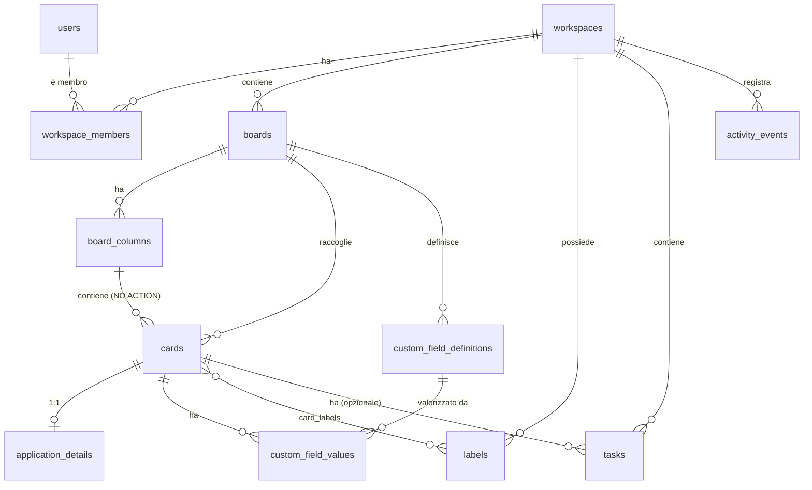

# Database

D1 (SQLite) con Drizzle ORM. Lo schema è in [`packages/database/src/schema.ts`](../../packages/database/src/schema.ts);
le migrazioni SQL generate sono in `packages/database/migrations/`.

## Modello



16 tabelle (M3-C2: `card_notes`, `card_documents`; M2.5: `interviews`): `users`, `workspaces`, `workspace_members`, `boards`, `board_columns`, `cards`, `application_details`,
`custom_field_definitions`, `custom_field_values`, `labels`, `card_labels`, `tasks`, `activity_events`, `interviews`, `card_notes`, `card_documents`.
Descrizione delle entità: [domain-model](../product/domain-model.md).

## Convenzioni

| Tema               | Scelta                                                                                                                                    |
| ------------------ | ----------------------------------------------------------------------------------------------------------------------------------------- |
| ID                 | UUID testuale generato dall'applicazione (`crypto.randomUUID()`)                                                                          |
| Timestamp          | Interi: millisecondi Unix **UTC**. Generati dal server, mai dal client                                                                    |
| Date di calendario | Testo `YYYY-MM-DD` (pubblicazione, candidatura): non dipendono dal fuso orario                                                            |
| Scadenze           | Istante assoluto UTC (`tasks.due_at`); si mostrano nel fuso del workspace (`workspaces.timezone`)                                         |
| Tenancy            | **`workspace_id` su ogni tabella di dominio**, così ogni query filtra per tenant senza join                                               |
| Vocabolari         | Colonne `text` con vincolo **CHECK** derivato dalle costanti in `packages/shared`                                                         |
| Importi            | Unità intere della valuta (non centesimi), con `currency` ISO 4217 e `salary_period`                                                      |
| JSON               | Solo per configurazione (`custom_field_definitions.config`) e valori (`custom_field_values.value`), validati da Zod prima della scrittura |

## Integrità garantita dal database

Verificata da `apps/api/test/database.test.ts` e `tenant-integrity.test.ts` sulle **migrazioni reali** (0000 + 0001):

- CHECK su priorità, fase, esito, modalità di lavoro, tipo di contratto, periodicità, tipo di campo, tipo di evento, ruolo, categoria di colonna.
- `salary_min <= salary_max`.
- `users.email` sempre minuscola e univoca; etichette univoche per workspace **senza distinguere maiuscole** (`lower(name)`).
- **Isolamento tra workspace** (migrazione `0001`, [ADR-0007](decisions/0007-database-tenant-isolation.md)): ogni riferimento tra tabelle usa una **FK composita con `workspace_id`**; una scheda può puntare solo a una colonna della **stessa bacheca e dello stesso workspace**. Il database rifiuta qualunque associazione tra workspace diversi anche con ID esistenti.
- `cards.column_id → board_columns` è **`NO ACTION`** (verificata a fine istruzione): una colonna con schede non si elimina da sola, mentre l'eliminazione di una bacheca o di un workspace (colonne e schede nella stessa istruzione) riesce in modo deterministico.
- **Trigger** (solo nell'SQL di `0001`, non modellati da drizzle): `activity_events` (scheda, bacheca e autore dello stesso workspace), coerenza scheda↔campo personalizzato (stessa bacheca), divieto di cambiare bacheca a una scheda con valori di campi.
- `ON DELETE CASCADE` da scheda a dettagli, valori e etichette; da workspace a tutto il suo contenuto.
- `activity_events` usa `SET NULL` per scheda/bacheca/autore: la cronologia sopravvive all'eliminazione dell'oggetto.
- Foreign key attive (D1 le applica sempre).

## Fase ed esito sono concetti distinti

`application_details.stage` (fase semantica del processo) ed `outcome` (esito) sono indipendenti dalla colonna
Kanban in cui si trova la scheda (`cards.column_id`). `board_columns.category` dichiara la fase di default di una
colonna: spostare una scheda può _proporre_ un cambio di fase, ma l'utente può rinominare e riordinare le colonne
liberamente senza rompere le statistiche, che si basano su `stage`/`outcome`.

## Posizioni Kanban (da implementare in M1)

Decisione (ADR-0004): `position` intera con **gap** (passo 1024) e inserimento nel punto medio; ribilanciamento
della sola colonna quando il gap si esaurisce. D1 non ha transazioni interattive, quindi uno spostamento è un
`batch()` transazionale con `UPDATE … WHERE id = ? AND workspace_id = ?` e condizioni nel SQL; il servizio
restituisce lo stato aggiornato e il client applica l'aggiornamento ottimistico con rollback in caso di errore.

## Migrazioni

```bash
pnpm db:generate         # drizzle-kit genera SQL da schema.ts (non tocca alcun database)
pnpm db:migrate:local    # wrangler d1 migrations apply DB --local --env dev
pnpm db:check            # fallisce se schema.ts non corrisponde alle migrazioni committate (in CI)
```

Regole:

- Si rivede l'SQL generato; **non si modificano migrazioni già applicate**; ogni modifica distruttiva richiede una migrazione dedicata e un piano di backup.
- **D1 non supporta `PRAGMA foreign_keys`** nelle migrazioni. SQLite non ha `ADD FOREIGN KEY`: per aggiungere vincoli a una tabella la si ricrea. L'SQL generato da drizzle-kit per questo caso (copia/rinomina con `PRAGMA foreign_keys=OFF`) **non va applicato così com'è**: va riscritto a mano come in `0001` (guardia + drop/create dei figli prima dei genitori).
- Una migrazione che elimina tabelle deve aprire con una **guardia** `CHECK` che la interrompe se contengono righe (vedi `0001`).
- Una ricostruzione di tabelle con drizzle-kit **non ricrea i trigger**: vanno riscritti a mano.
- I test dell'API applicano le migrazioni reali a un D1 isolato; un test prova anche l'aggiornamento di un database con dati.

## Backup e ripristino (progettazione)

Non implementati in M0 (nessun dato di produzione). Piano per la release privata (M4):

1. **D1 Time Travel**: ripristino a un istante degli ultimi 30 giorni, senza configurazione.
2. **Export periodico** (`wrangler d1 export`) verso R2 con retention definita; cifrato, accesso ristretto.
3. **Prova di ripristino** documentata prima della release (un backup non provato non è un backup).
4. Esportazione dati per l'utente (M4) come meccanismo separato di portabilità.

Per la release pubblica (M5): politica di retention, ripristino per singolo workspace, cancellazione definitiva
anche dai backup entro un termine dichiarato (GDPR).

## Eliminazione di account e dati (progettazione per M5)

Il modello lo rende possibile: ogni dato di un utente discende da un `workspace`, e `ON DELETE CASCADE` da
`workspaces` rimuove l'intero contenuto. Resta da definire il flusso (conferma, periodo di grazia, export
preventivo) e la gestione dei backup.
