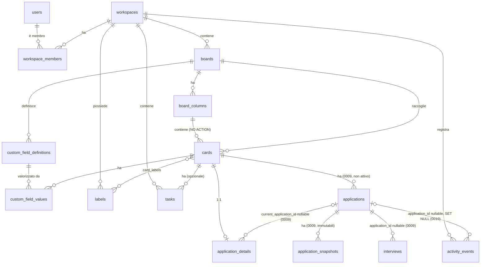

# Database

> **Avviso (PID-01, 2026-11-22):** le sezioni sulle migrazioni `0009`, `0010` e `0011` (SW.10) descrivono un percorso **sostituito** dalla base unica `0000_jobward_v1` più le additive `0001_companies` e `0002_saved_views` ([ADR-0017](decisions/0017-local-v1-baseline.md)); gli script e i test che citano (`scripts/test-migration-*`, `scripts/audit/`, `*-schema.test.ts`) non esistono su `jobward-v1`. Sono superate anche le affermazioni «18 tabelle» (oggi 20), «candidature non attive / nessun servizio» (oggi scritte da pipeline e candidature), `current_application_id` (non esiste) e l'esportazione «futura» (esiste). Catalogo as-built: [DATA-MODEL](DATA-MODEL.md). Restano validi: convenzioni, integrità garantita dal database, fase ≠ esito, backup e cancellazione (progettazione).

D1 (SQLite) con Drizzle ORM. Lo schema è in [`packages/database/src/schema.ts`](../../packages/database/src/schema.ts);
le migrazioni SQL generate sono in `packages/database/migrations/`.

## Modello



18 tabelle (M3-C2: `card_notes`, `card_documents`; M2.5: `interviews`; M5-SW.10-b: `applications`, `application_snapshots`): `users`, `workspaces`, `workspace_members`, `boards`, `board_columns`, `cards`, `application_details`,
`custom_field_definitions`, `custom_field_values`, `labels`, `card_labels`, `tasks`, `activity_events`, `interviews`, `card_notes`, `card_documents`, `applications`, `application_snapshots`.
Le ultime due (migrazione `0009`) sono **strutture non ancora attive**: nessun servizio, rotta o interfaccia le legge o le scrive (vedi «Candidature e snapshot»).
Descrizione delle entità: [domain-model](../product/domain-model.md).

## Convenzioni

| Tema               | Scelta                                                                                                                                    |
| ------------------ | ----------------------------------------------------------------------------------------------------------------------------------------- |
| ID                 | UUID testuale generato dall'applicazione (`crypto.randomUUID()`)                                                                          |
| Timestamp          | Interi: millisecondi Unix **UTC**. Generati dal server, mai dal client                                                                    |
| Date di calendario | Testo `YYYY-MM-DD` (pubblicazione, candidatura): non dipendono dal fuso orario                                                            |
| Scadenze           | Istante assoluto UTC (`tasks.due_at`); si mostrano nel fuso del workspace (`workspaces.timezone`)                                         |
| Tenancy            | **`workspace_id` su ogni tabella di dominio**, così ogni query filtra per tenant senza join                                               |
| Vocabolari         | Colonne `text` con vincolo **CHECK** derivato dalle costanti in `packages/shared`                                                         |
| Importi            | Unità intere della valuta (non centesimi), con `currency` ISO 4217 e `salary_period`                                                      |
| JSON               | Solo per configurazione (`custom_field_definitions.config`) e valori (`custom_field_values.value`), validati da Zod prima della scrittura |

## Integrità garantita dal database

Verificata da `apps/api/test/database.test.ts` e `tenant-integrity.test.ts` sulle **migrazioni reali** (0000 + 0001):

- CHECK su priorità, fase, esito, modalità di lavoro, tipo di contratto, periodicità, tipo di campo, tipo di evento, ruolo, categoria di colonna.
- `salary_min <= salary_max`.
- `users.email` sempre minuscola e univoca; etichette univoche per workspace **senza distinguere maiuscole** (`lower(name)`).
- **Isolamento tra workspace** (migrazione `0001`, [ADR-0007](decisions/0007-database-tenant-isolation.md)): ogni riferimento tra tabelle usa una **FK composita con `workspace_id`**; una scheda può puntare solo a una colonna della **stessa bacheca e dello stesso workspace**. Il database rifiuta qualunque associazione tra workspace diversi anche con ID esistenti.
- **Posizionamento facoltativo** (migrazione `0008`, M5-SW.10-a, [ADR-0016](decisions/0016-smart-workspace-domain.md)): `cards.board_id` e `cards.column_id` sono **entrambi valorizzati o entrambi NULL** (`CHECK cards_placement_pair`). Una scheda senza bacheca è un'opportunità che non appartiene a nessuna bacheca. Con una colonna NULL le FK composite **non si applicano** (MATCH SIMPLE): il CHECK è indispensabile, altrimenti una scheda con la sola bacheca valorizzata passerebbe.
- `cards.board_id → boards` e `cards.column_id → board_columns` sono **`NO ACTION`** (verificate a fine istruzione): una colonna con schede non si elimina da sola, e **eliminare una bacheca che ha ancora schede fallisce senza cancellare nulla** (fail-closed). `deleteBoard` scollega le schede (`board_id`/`column_id` NULL) prima di eliminare la bacheca; eliminare un workspace (schede e bacheche nella stessa istruzione) riesce in modo deterministico.
- **Trigger** (solo nell'SQL, non modellati da drizzle; `db:check` **non li vede**): `activity_events` (scheda, bacheca e autore dello stesso workspace; `0001`/`0002`), coerenza scheda↔campo personalizzato (stessa bacheca; `0001`), divieto di cambiare o togliere la bacheca a una scheda con valori di campi (`cards_board_change_custom_values`, ricreato in `0008` con `IS NOT` perché il confronto con NULL del vecchio `<>` non bloccava lo scollegamento).
- `ON DELETE CASCADE` da scheda a dettagli, valori e etichette; da workspace a tutto il suo contenuto. **Una bacheca non possiede le opportunità**: la sua eliminazione rimuove colonne, campi personalizzati e i loro valori, non le schede.
- `activity_events` usa `SET NULL` per scheda/bacheca/autore e (da `0010`) candidatura: la cronologia sopravvive all'eliminazione dell'oggetto. Poiché le schede non vengono più eliminate con la bacheca, gli eventi perdono solo il riferimento alla **bacheca** e conservano quello alla scheda.
- Foreign key attive (D1 le applica sempre).

## Candidature e snapshot (migrazione `0009`, M5-SW.10-b)

Strutture della relazione **Opportunity 1:N Application** ([ADR-0016](decisions/0016-smart-workspace-domain.md) D4/D6/D13). L'opportunità è la riga `cards` (nome fisico invariato). **Nessun servizio le usa ancora**: niente dual-write, backfill, rotte o interfaccia (SW.10-c/d e gli switch). `0009` è **solo additiva**: due tabelle, due colonne NULLABLE, indici e trigger; nessun dato esistente viene letto, scritto o modificato.

| Oggetto                                      | Contenuto                                                                                                                                                                                                                          |
| -------------------------------------------- | ---------------------------------------------------------------------------------------------------------------------------------------------------------------------------------------------------------------------------------- |
| `applications`                               | `id`, `workspace_id`, `opportunity_id`, `sequence`, `stage`, `outcome`, `applied_on`, `origin` (`user`/`backfill`), `backfill_rule`, `request_fingerprint`, `created_at`, `updated_at`. Nessun tetto al numero per opportunità.    |
| `application_snapshots`                      | `id`, `workspace_id`, `application_id`, `version`, `source` (`submit`/`backfill`), `backfill_rule`, `title`, dati dell'annuncio e della retribuzione (colonne esplicite), `created_at`. Nessun JSON libero, nessuna `description`. |
| `application_details.current_application_id` | Puntatore denormalizzato alla candidatura corrente (D4). NULLABLE, FK `SET NULL`. Nessuno lo scrive ancora.                                                                                                                        |
| `interviews.application_id`                  | Candidatura del round (D6). NULLABLE, FK `NO ACTION`. `card_id` e `UNIQUE(card_id, sequence)` restano. Nessuno lo scrive ancora.                                                                                                   |
| `card_notes`, `card_documents`               | **Nessun** `application_id`: la decisione S6-10 lo rinvia a SW.14.                                                                                                                                                                 |

Garanzie del database (provate da `apps/api/test/applications-schema.test.ts` e `scripts/test-migration-applications.mjs`):

- **Isolamento**: FK composita `(opportunity_id, workspace_id) → cards(id, workspace_id)`; uno snapshot punta a `applications(id, workspace_id)`. Una candidatura o uno snapshot non possono collegare risorse di workspace diversi.
- **Sequenza**: `UNIQUE(opportunity_id, sequence)`, `sequence ≥ 1`, e un trigger che in inserimento la vuole **strettamente crescente** per opportunità (i salti sono ammessi). Il **non-riuso** è garantito perché una candidatura **non si elimina da sola** (`applications_no_direct_delete`): sparisce solo come cascata dell'opportunità o del workspace. Se in futuro servirà «elimina candidatura», sarà una migrazione approvata che rimuove quel trigger e introduce un contatore.
- **Vocabolari**: CHECK su `stage`, `outcome` (NULL = non specificato), `origin`, `source`, e su `origin = 'backfill'` ⇔ `backfill_rule` valorizzata (lunghezza 1–64). Nessun DEFAULT su `origin`: chi scrive lo dichiara. Le regole di coerenza fase↔esito restano del servizio.
- **Idempotenza**: indice univoco **parziale** `(opportunity_id, request_fingerprint) WHERE request_fingerprint IS NOT NULL`. In SQLite i NULL sono distinti in un indice univoco, quindi più candidature senza fingerprint (legacy, backfill) coesistono; due con lo stesso fingerprint sulla stessa opportunità no; lo stesso fingerprint su un'altra opportunità o in un altro workspace è ammesso. Il fingerprint è di 64 caratteri (la stringa vuota è rifiutata). **Contratto per il servizio (SW.10-c)**: il fingerprint deve includere l'ID/operazione stabile del client, altrimenti due candidature legittime identiche collidono.
- **Identità immutabile** (`applications_identity_immutable`): `id`, `workspace_id`, `opportunity_id`, `sequence`, `origin`, `backfill_rule`, `request_fingerprint` e `created_at` non cambiano dopo la scrittura; `stage`, `outcome`, `applied_on`, `updated_at` sì. `INSERT OR REPLACE` e upsert su una candidatura esistente sono rifiutati (`applications_insert_guard`): altrimenti un REPLACE la cancellerebbe, e la cascata cancellerebbe gli snapshot.
- **Snapshot immutabili**: solo colonne esplicite (campi consentiti); `UPDATE` sempre rifiutato (anche senza cambiare il valore); `DELETE` diretto rifiutato; `INSERT OR REPLACE` e upsert rifiutati (SQLite, con `recursive_triggers` spento, non esegue i trigger di DELETE di un REPLACE: lo blocca `application_snapshots_insert_guard`). `version ≥ 1` univoca per candidatura; al più **un** snapshot `backfill` per candidatura. Il DELETE è consentito **solo come cascata** (candidatura → opportunità → workspace): il trigger rifiuta solo se esistono ancora sia il workspace sia la candidatura. Questo dipende da un comportamento di SQLite verificato (la riga padre è già eliminata quando parte l'azione sui figli) ed è coperto dai test su D1 locale.
- **Onestà dei dati**: `source = 'backfill'` è **ricostruito dai dati correnti**, non è un fatto storico verificato; `created_at` è il momento in cui la riga è scritta. Chi lo mostra deve dichiararlo «ricostruito».
- **Coerenza dei collegamenti legacy**: le FK composite non si aggiungono con `ALTER`; la regola «se valorizzati, la candidatura è della stessa opportunità e dello stesso workspace» è imposta dai trigger `application_details_current_application_*` e `interviews_application_match_*` (`card_id` del colloquio = `opportunity_id` della candidatura). Sono NULL-safe (`IS NOT`): NULL è sempre ammesso.
- **Cancellazione**: eliminare un'opportunità o un workspace con candidature, snapshot, colloqui collegati e puntatori riesce; eliminare una bacheca non tocca le candidature.

### Decisioni del proprietario su `0009` (2026-11-11)

- **D1 — Cancellazione (approvazione TEMPORANEA).** `applications_no_direct_delete` è approvato come misura transitoria, **non** come decisione di prodotto. La futura gestione delle candidature dovrà distinguere quattro operazioni: **ritiro** (esito `withdrawn`), **archiviazione**, **eliminazione esplicita** e **cancellazione del workspace**. Questa migrazione non ne implementa nessuna nuova: l'unica eliminazione possibile resta la cascata di opportunità o workspace. Le sequenze già assegnate **non si riutilizzano mai**; se l'eliminazione esplicita diventerà possibile, servirà una migrazione approvata che rimuova il trigger **e** introduca un contatore persistente per opportunità (oggi il non-riuso discende solo dall'impossibilità di togliere la riga con il massimo).
- **D2 — Sequenze e snapshot.** Approvati: sequenze strettamente crescenti; unicità del fingerprint per opportunità; **un solo** snapshot di backfill per candidatura; backfill deterministico e idempotente (SW.10-d).
- **D3 — Colloqui.** `interviews.application_id` è `NO ACTION`; `card_id` e i vincoli legacy restano. Eliminare una candidatura che ha colloqui collegati richiederà una **procedura esplicita** (ricollocare o eliminare prima i round, dentro la stessa operazione), mai una cascata silenziosa.

### Requisiti di concorrenza (per il servizio che scriverà, SW.10-c/d e gli switch)

Il database garantisce l'**invariante**; il servizio deve evitare che l'invariante diventi un errore visibile. Provato oggi: unicità, trigger e rifiuto dei duplicati con inserimenti **sequenziali** (`apps/api/test/applications-schema.test.ts`). **Non provato** (nessun servizio esiste): due richieste simultanee reali. Requisiti:

1. **Sequenza calcolata nello stesso statement dell'INSERT** (`SELECT COALESCE(MAX(sequence), 0) + 1 … WHERE opportunity_id = ?`), mai letta prima e poi scritta: una lettura separata fa assegnare lo stesso numero a due richieste. D1 serializza le scritture di un database, ma non il «leggi poi scrivi» del Worker.
2. Se due inserimenti calcolano lo stesso numero, il secondo viene rifiutato (`UNIQUE(opportunity_id, sequence)` e `applications_insert_guard`): il servizio ritenta con un numero di tentativi **limitato** e poi restituisce un errore esplicito di conflitto; non si assegna mai un numero a mano né si usa `INSERT OR REPLACE`.
3. **Idempotenza**: il fingerprint include l'ID stabile dell'operazione del client. Un retry con lo stesso fingerprint non crea una seconda riga (`ON CONFLICT … DO NOTHING` o rilettura): restituisce la candidatura già creata, con la stessa sequenza. Due candidature distinte e legittime identiche **devono** avere ID operazione diversi.
4. Candidatura e snapshot `submit` si scrivono nello **stesso `batch`** (transazione D1): non esiste una candidatura inviata senza il suo primo snapshot.
5. Un test con due richieste concorrenti sulla stessa opportunità (stessa e diversa operazione) è condizione per attivare qualunque scrittura; fa parte del lavoro che attiva il dominio, non di `0009`.

### Snapshot versionati

Uno snapshot non si modifica né si elimina da solo: ogni cambiamento dei dati dell'opportunità che si vuole documentare è una **nuova riga** con `version` = precedente + 1 (`UNIQUE(application_id, version)`; i salti sono ammessi dal database, il servizio assegna la versione con la stessa tecnica della sequenza). `source = 'submit'` documenta lo stato al momento dell'invio; `source = 'backfill'` è **ricostruito dai dati correnti**, ne esiste al più uno per candidatura e non è un fatto storico (l'interfaccia lo dichiara «ricostruito»). Uno snapshot di backfill e uno `submit` possono coesistere per la stessa candidatura con versioni diverse; quale mostrare è una regola del servizio. `created_at` è il momento di scrittura della riga, non della verità storica dei valori.

### Semantica di `stage` e `outcome` nullable

`applications.stage` e `applications.outcome` sono nullable **come in `application_details`**; `NULL` significa «non specificato», mai «iniziale» né «negativo» (non si deduce). Il database impone solo il vocabolario; la coerenza tra i campi è del servizio. Tabella di riferimento:

| Situazione                   | `stage`                                                                                                            | `outcome`                                      | `applied_on`                                                              | Chi lo impone                                                                                                                                                                                                                                                      |
| ---------------------------- | ------------------------------------------------------------------------------------------------------------------ | ---------------------------------------------- | ------------------------------------------------------------------------- | ------------------------------------------------------------------------------------------------------------------------------------------------------------------------------------------------------------------------------------------------------------------ |
| **Bozza** (non presentata)   | `NULL`, `saved` o `preparing`                                                                                      | `NULL`                                         | `NULL`                                                                    | Servizio (futuro). Non c'è snapshot `submit`. Il database la ammette ma non la distingue da altre righe.                                                                                                                                                           |
| **Candidatura presentata**   | `applied`, `in_contact`, `interviewing`, `offer` (`SUBMITTED_STAGES`) oppure `closed` con `applied_on` valorizzata | `NULL` o `pending` finché è attiva             | valorizzata all'invio (non imposto: la legacy ha fasi inviate senza data) | Servizio (futuro) e transizioni di pipeline; snapshot `submit` scritto con l'invio. Per le statistiche «inviata» = `applied_on` non NULL **oppure** fase in `SUBMITTED_STAGES`, come oggi.                                                                         |
| **Chiusa**                   | `closed`                                                                                                           | uno qualunque dei valori                       | invariata                                                                 | Servizio. Per D4 non è «attiva». `closed` senza invio non è «presentata».                                                                                                                                                                                          |
| **Record di backfill**       | quella di `application_details` (anche `NULL`)                                                                     | quello di `application_details` (anche `NULL`) | quella di `application_details` (anche `NULL`)                            | `origin = 'backfill'` con `backfill_rule`; copia fedele, **nessuna normalizzazione o deduzione**. Se il backfill debba creare una candidatura per le sole opportunità senza invio (`NULL`/`saved`/`preparing`, senza data) è una decisione di SW.10-d, vedi sotto. |
| **Validazione SQL (`0009`)** | `NULL` o uno dei 7 valori                                                                                          | `NULL` o uno dei 6 valori                      | nessun controllo di formato                                               | `CHECK` + trigger di identità. **Non** vietati: `outcome` senza `stage`, `accepted` con `saved`, `applied_on` con fase non inviata.                                                                                                                                |
| **Contratti API futuri**     | `nullable` come `card.ts` (`z.enum(STAGES).nullable()`)                                                            | `nullable`                                     | `YYYY-MM-DD` o `null`                                                     | Lo schema Zod dovrà rifiutare le combinazioni incoerenti che il database ammette (es. esito conclusivo con fase non inviata), con messaggi dedicati; nessun valore sentinella `''`.                                                                                |

Nessuna contraddizione sostanziale con D4/D13 e col codice esistente: la regola D4 della candidatura corrente (non ancora implementata) tratta «esito assente o `pending`» come attivo, cioè legge `NULL` e `pending` allo stesso modo, e le statistiche attuali (`overview.ts`) già considerano inviata una scheda con `applied_on` o fase in `SUBMITTED_STAGES`. Restano **due punti aperti**, non contraddizioni, da decidere prima di SW.10-d: (a) se il backfill crei una candidatura per ogni `application_details` o solo per quelle «presentate» (una bozza legacy `NULL`/`saved` senza data è oggi un'opportunità, non una candidatura); (b) se `closed` senza `applied_on` conti come candidatura presentata (oggi no, per le statistiche). Nessuno dei due è deciso né implementato da `0009`.

I trigger di `0009` (10) vivono solo nell'SQL, come quelli di `0001`/`0004`: `db:check` non li vede, li provano i due test sopra. Nota di strumento: per un `ALTER TABLE … ADD … REFERENCES` drizzle-kit omette `ON DELETE`; la migrazione scrive le azioni esplicitamente e lo script di aggiornamento le confronta con lo snapshot.

## Cronologia e candidature (migrazione `0010`, M5-SW.10-c)

`activity_events` viene **ricostruita una tantum** per tre motivi: aggiungere `application_id` (nullable), aggiungere tre tipi evento al `CHECK` del tipo (SQLite non permette di modificarlo con `ALTER`), e dotare i soli tipi nuovi di vincoli di idempotenza e di payload. **Non attiva nulla**: nessun servizio emette i nuovi eventi, `deleteBoard` non scrive `card_unplaced`, nessun backfill, nessun dual-write, nessuna rotta nuova. Gli eventi storici sono conservati **byte per byte** e non vengono reinterpretati (`application_id` è NULL per tutti; `card_moved` resta com'è).

### Decisioni del proprietario su `0010` (2026-11-11)

- **D1 — Backfill.** Il backfill `0011` **non genera** `application_created` per le candidature ricostruite: usa `origin = 'backfill'` e i relativi marcatori; non si inventano date, azioni o attori storici. Il database lo impone: un `application_created` che riferisce una candidatura con `origin = 'backfill'` è rifiutato.
- **D2 — Tipi.** Aggiunti `application_created`, `card_placed`, `card_unplaced`; `card_moved` resta.
- **D3 — Posizionamento (contratto per le operazioni future, non per il servizio di oggi).** Spostamento tra colonne della stessa bacheca → `card_moved`. Rimozione dell'appartenenza → `card_unplaced`. Nuova appartenenza → `card_placed`. Trasferimento tra bacheche → la **coppia** `card_unplaced` + `card_placed` con lo **stesso `operation_id`**.
- **D4 — Deduplicazione.** Chiavi deterministiche che includono tipo, entità, identificatore, operazione e, per il posizionamento, la bacheca di origine/destinazione.
- **D5 — Metadati.** JSON strutturato e versionato; solo identificatori, riferimenti a bacheca/colonna, direzione, versione del payload e un motivo strutturato; mai note, descrizioni di offerte, nomi di persone, documenti o testo libero.
- **D6 — Attivazione.** La migrazione predispone, **non attiva**. L'emissione avverrà in una fase successiva con test dedicati.

### Modello degli eventi

| Tipo (nuovo)          | Verrà emesso quando (fase successiva)                                | Colonne                                               | Payload `v: 1`                                                      | Chiave di deduplica (`dedupe_key`)                                         |
| --------------------- | -------------------------------------------------------------------- | ----------------------------------------------------- | ------------------------------------------------------------------- | -------------------------------------------------------------------------- |
| `application_created` | l'utente crea una candidatura (mai per `origin = 'backfill'`)        | `card_id`, **`application_id` obbligatorio**          | `v`, `applicationId`, `sequence`, `origin` (`user`)                 | `["application_created","application",<id candidatura>,<id operazione>]`   |
| `card_placed`         | una scheda entra in una bacheca (o seconda metà di un trasferimento) | **`card_id` obbligatorio**, `board_id` = destinazione | `v`, `direction: "placed"`, **`boardId`**, `columnId`, `reason?`    | `["card_placed","card",<id scheda>,<id operazione>,"to",<id bacheca>]`     |
| `card_unplaced`       | una scheda esce da una bacheca (o prima metà di un trasferimento)    | **`card_id` obbligatorio**, `board_id` = origine      | `v`, `direction: "unplaced"`, **`boardId`**, `columnId?`, `reason?` | `["card_unplaced","card",<id scheda>,<id operazione>,"from",<id bacheca>]` |

`reason` è un valore strutturato (`user`, `board_deleted`, `transfer`), mai testo. `boardId`, `applicationId` e `direction` stanno **anche nel payload** perché le colonne `board_id`/`card_id`/`application_id` diventano NULL se l'oggetto viene eliminato: il contesto storico di una bacheca eliminata sopravvive nel payload. I **nomi** di bacheca e colonna non si registrano (sono testo libero dell'utente): dopo l'eliminazione resta l'identificatore, non il nome.

### Vincoli e trigger

- **FK semplice** `application_id → applications(id) ON DELETE SET NULL`. Una FK composita `(application_id, workspace_id)` con `SET NULL` azzererebbe anche `workspace_id` (NOT NULL): per questo l'isolamento è dei trigger, come per le altre FK della tabella.
- `activity_events_application_match_insert` / `_update` (NULL-safe): se `application_id` è valorizzato la candidatura deve esistere **nello stesso workspace** dell'evento e, se `card_id` è valorizzato, appartenere **alla stessa opportunità**. `card_id` NULL con `application_id` valorizzato è ammesso (il controllo di workspace non ne dipende). L'UPDATE controlla solo se cambiano `application_id`, `card_id` o `workspace_id`: gli azzeramenti `SET NULL` delle cascate non scattano.
- `activity_events_new_types_guard` (solo INSERT dei tre tipi nuovi): `application_created` richiede `application_id` coerente col payload e rifiuta le candidature ricostruite; `card_placed`/`card_unplaced` richiedono `card_id` e, se `board_id` è valorizzato, deve coincidere con `boardId` del payload.
- `CHECK` per i soli tipi nuovi (gli storici non sono toccati): `activity_events_new_types_dedupe` (chiave obbligatoria, JSON, primo elemento = tipo), `activity_events_new_types_version` (payload oggetto con `v` intero ≥ 1), `activity_events_placement_payload` (`boardId` testuale e `direction` coerente col tipo), `activity_events_application_payload` (`applicationId` testuale). Ogni espressione JSON è chiusa con `coalesce(…, 0)`: un `CHECK` passa se vale NULL, e «JSON non valido» o «campo mancante» devono fallire.
- I 2 trigger tenant (`0001`/`0002`/`0005`) e i 4 indici preesistenti sono **ricreati con lo stesso testo**; nuovo indice parziale `(application_id, occurred_at) WHERE application_id IS NOT NULL`.
- **Semantica di `application_id`**: NULL per ogni evento storico e per gli eventi che riguardano l'opportunità nel suo insieme; qualunque tipo può riferire una candidatura (non è riservato ai tipi nuovi). Sparisce (SET NULL) solo con la candidatura, cioè con la cascata di opportunità o workspace; la riga dell'evento resta.

### Contratto di deduplicazione

L'indice esistente `activity_events_dedupe_unique (workspace_id, dedupe_key) WHERE dedupe_key IS NOT NULL` è **l'unico meccanismo**; non si introducono indici nuovi. Le chiavi si producono con `applicationCreatedDedupeKey` e `placementDedupeKey` (`packages/shared/src/timeline.ts`), array JSON quindi non ambigui. Garanzie provate: due eventi **distinti della stessa operazione** (le metà di un trasferimento) coesistono perché il tipo e il lato (`from`/`to`) cambiano la chiave; la **stessa** chiave in un retry è rifiutata (e `INSERT OR IGNORE` non scrive nulla); la bacheca entra nella chiave; la stessa chiave in un altro workspace è ammessa; una chiave a 6 elementi non può collidere con le legacy a 4. `operation_id` e `request_fingerprint` seguono il vincolo esistente (entrambi o nessuno): le due metà di un trasferimento condividono entrambi.

### Compatibilità della cronologia (D6)

I tre tipi sono in `ACTIVITY_EVENT_TYPES` (in coda: l'ordine è quello del `CHECK`) **e** in `DORMANT_ACTIVITY_EVENT_TYPES`. Finché un tipo è «dormiente»: `GET /cards/:id/timeline` e il dettaglio della scheda lo **escludono in SQL** (non consuma il limite della pagina né altera il cursore), `mergeTimeline` lo scarta per difesa, e nessuna voce può comparire con un'etichetta non definita. Attivare un tipo significa toglierlo da quell'elenco e aggiungere etichette e test. Gli schemi DTO accettano comunque tutti i tipi (tolleranza in lettura). Il Query Engine v2 non legge `activity_events`: la sua compatibilità è provata a parità di risultati con eventi e candidature nuovi presenti.

### Ricostruzione, guardie e recupero

`activity_events` è una tabella **foglia** (nessuna FK la referenzia): il `DROP` non fa cascata. Ordine: guardia 0 (esiste `applications`, `activity_events` è ancora nella forma `0009`) → copia `_m10_bak` a colonne **senza tipo** → guardia A (copia identica riga per riga, tipi e valori, via `json_array`) → `DROP` e `CREATE` con il nome definitivo → ripristino con **11 colonne esplicite** (`application_id` resta NULL) → guardia B (stessa verifica contro la copia, nessun `application_id`) → indici e trigger → pulizia. D1 applica il file in una transazione: una guardia che fallisce annulla tutto (provato con guasti anche **dopo** il `DROP`). Note di strumento: D1 limita la profondità delle espressioni a 100, per questo la guardia usa `json_array` e non una lunga concatenazione di `quote()`. **Backup**: prima di qualunque applicazione reale servono un backup a freddo verificato e, su remoto, tabelle piccole (l'atomicità remota non è provata); il recupero e la riesecuzione sono provati in `scripts/test-migration-activity-events.mjs`.

### Impatto su `0011` (backfill)

_Vedi anche [Backfill delle candidature (`0011`)](#backfill-delle-candidature-migrazione-0011-m5-sw10-d)._

Nessun evento per le candidature ricostruite (D1), garantito dal database. `application_id` degli eventi storici resta NULL: collegare gli eventi esistenti alle candidature ricostruite **non** è previsto (sarebbe una reinterpretazione); la cronologia di un'opportunità continua a leggersi per `card_id`. Il backfill non scrive in `activity_events`.

## Backfill delle candidature (migrazione `0011`, M5-SW.10-d)

> **Stato (2026-11-12):** la migrazione è **scritta e provata solo su database sintetici**. **Non è applicata a nessun database reale** (locale persistente, staging, produzione) e non è committata. Politica: `sw10-backfill-policy/1`; manifest: `scripts/audit/sw10d0/policy-manifest.json`; ADR: [0016](decisions/0016-smart-workspace-domain.md).

`0011_application_backfill.sql` è una migrazione **di soli dati**: nessuna colonna, tabella, indice o trigger permanente. Crea una candidatura (`applications`, `sequence = 1`, `origin = 'backfill'`) e il suo snapshot (`application_snapshots`, `version = 1`, `source = 'backfill'`) **soltanto** per le opportunità classificate SUBMITTED o DRAFT dalla politica. AMBIGUOUS e NO_APPLICATION non producono nulla. Il file è **generato** da `scripts/audit/sw10d0/migration-0011.mjs` (`--write` / `--check`) a partire dal testo esatto di `CLASSIFIER_SQL`: non si modifica a mano.

### Classificazione (sintesi)

| Categoria      | Regole (`backfill_rule`)                                                                                                                                                                                                                                                                                           | Crea? |
| -------------- | ------------------------------------------------------------------------------------------------------------------------------------------------------------------------------------------------------------------------------------------------------------------------------------------------------------------ | ----- |
| SUBMITTED      | `legacy_applied_on` (data valida e fase non preparatoria), `legacy_submission_event` (`application_submitted` interpretabile e non di correzione, con dettagli)                                                                                                                                                    | sì    |
| DRAFT          | `legacy_stage_preparing` (fase `preparing` esplicita, nessuna evidenza contraria, nessuno storico)                                                                                                                                                                                                                 | sì    |
| AMBIGUOUS      | `dated_pre_stage`, `event_pre_stage`, `event_without_details`, `applied_without_evidence`, `in_contact_without_evidence`, `advanced_stage_without_evidence`, `closed_without_evidence`, `outcome_without_submission`, `interviews_without_submission`, `applied_on_malformed`, `weak_history_only`, `unclassified` | no    |
| NO_APPLICATION | `no_details`, `saved_no_signals`, `details_without_stage`                                                                                                                                                                                                                                                          | no    |

La fase da sola, `stage_changed`, `card_moved`, le correzioni, i colloqui e gli esiti non sono prove di invio (decisioni Q1/Q2 confermate). Gli identificatori ritirati (`legacy_stage_submitted`, `legacy_event_submitted`, `legacy_in_contact_corroborated`) non si riusano.

### Dati scritti e semantica dei timestamp

| Colonna                                        | Valore                                                                            |
| ---------------------------------------------- | --------------------------------------------------------------------------------- |
| `applications.id` / `application_snapshots.id` | `'app-bf-' \|\| card_id` / `'snap-bf-' \|\| card_id` (deterministici)             |
| `stage`, `outcome`, `applied_on`               | copia **esatta** da `application_details` (valori e tipi SQLite), senza inferenze |
| `applications.created_at` / `updated_at`       | `application_details.created_at` / `updated_at`, **non** modificati               |
| `application_snapshots.created_at`             | `max(cards.updated_at, application_details.updated_at)`                           |
| `request_fingerprint`                          | `NULL`                                                                            |

`application_details.created_at` è la **prima scrittura dei dettagli**, non la data di invio; `updated_at` è l'ultima. Lo snapshot ha quindi un riferimento **tecnico** (l'ultima scrittura dei dati da cui è ricostruito), **mai** presentato come data storica di invio. La data storica, se nota, è `applied_on`. La migrazione non legge l'orologio (nessun `now`, `random`, `datetime`: test statico).

### Idempotenza, guardie e conflitti

- **Per Opportunity**: `NOT EXISTS (SELECT 1 FROM applications WHERE opportunity_id = … AND workspace_id = …)`. La ripetizione _logica_ del file sullo stesso database converge (nessuna riga aggiunta o modificata). Il tentativo di rieseguire una migrazione **già registrata nel journal** è respinto dal runner (drizzle `__drizzle_migrations`, wrangler `d1_migrations`), non dal file.
- **Guardie nominate** (`CHECK` di una tabella di lavoro: il nome compare nell'errore): `m11_g1_lineage_{tables,indexes,triggers}` (DDL esatto di 0000–0010, letto da `sqlite_master`: nessun `pragma_*`), `m11_g2_no_*_links` (nessun `current_application_id`/`interviews.application_id`/`activity_events.application_id`), `m11_g3_backfill_*_coherent`, `m11_g4_every_opportunity_classified`, `m11_g5_no_conflicting_application`, `m11_g6_no_silent_exclusion`, `m11_g7_only_qualified_rows`, `m11_g8_one_snapshot_per_application`, `m11_g9_*_exact_copy`, e tre `CHECK` sulla classificazione (`m11_class_*`: categoria e regola nel vocabolario del manifest, creazione coerente con la regola).
- **Conflitto non previsto = errore, mai esclusione silenziosa.** Una candidatura non di backfill (per esempio `origin='user'`) su un'opportunità qualificata che non ha ancora la candidatura di backfill fa fallire `m11_g5` (e, se mancasse, `m11_g6`). Le candidature utente su opportunità AMBIGUOUS/NO_APPLICATION, o già coperte da backfill, non sono in conflitto e restano intatte.
- **Lineage**: un database che non ha esattamente il DDL delle migrazioni canoniche 0000–0010 viene rifiutato (`m11_g1_*`). In particolare la lineage alternativa del ramo `m3-application-workflow` (`0005_m3_application_workflow`, che scrive anche `applied_on` in automatico) **non** è compatibile: richiede un'analisi separata, non la `0011`.
- **Tabelle di lavoro** (`_m11_g`, `_m11_pre`, `_m11_class`): create e rimosse dentro il file, come in `0008`; il file apre rimuovendo i residui di un tentativo interrotto in un runner non atomico. Sono l'unico DDL del file (la `0011` non crea oggetti permanenti).

### Rapporto di verifica

`node --no-warnings scripts/audit/sw10d0/backfill-report.mjs <copia.sqlite> [--json]` (sola lettura; rifiuta i percorsi di `.wrangler`/`state/v3`) elenca: migrati (SUBMITTED, DRAFT, archiviate incluse), esclusi con **codici di motivo** (identificatori delle regole) e conteggi, candidature già esistenti per origine, conflitti, anomalie (`applied_on` non valido, ordine dei timestamp, collegamenti legacy, colloqui senza candidatura). Non modifica le opportunità e non risolve gli AMBIGUOUS.

### Backup, recupero e rollback (procedura da approvare, non eseguita su dati reali)

1. **Prima**: backup a freddo del file D1 (copia del database a migrazione ferma) e **verifica** del backup ripristinandolo in un database temporaneo e confrontando schema e righe. Provato in sintetico con `VACUUM INTO` e con la copia dello stato D1 locale (`scripts/test-migration-application-backfill.mjs`).
2. **Prova a secco su una copia** del database da migrare (solo con approvazione del proprietario): rapporto sopra, poi `0011` sulla copia.
3. **Rollback preparato (R2)**: `scripts/audit/sw10d0/rollback-0011.mjs` — in **una** transazione: `DROP TRIGGER` dei due trigger di eliminazione di `0009` (`applications_no_direct_delete`, `application_snapshots_no_direct_delete`), `DELETE` degli snapshot `source='backfill'` e delle candidature `origin='backfill'`, ricreazione dei trigger con il testo originale. Una `DELETE` diretta è **rifiutata** dai trigger: senza R2 il backfill non si annulla. Le candidature `origin='user'` e tutti i dati legacy sono conservati (provato in sintetico: schema, tabelle e trigger identici a prima; la `0011` è poi ripetibile con lo stesso risultato).
4. **Non verificato**: atomicità su D1 **remoto**, limiti di tempo/dimensione di D1 per l'`INSERT … SELECT`, Time Travel. Prima di ogni ambiente reale: approvazione separata e, se remoto, un D1 di prova.

## Fase ed esito sono concetti distinti

`application_details.stage` (fase semantica del processo) ed `outcome` (esito) sono indipendenti dalla colonna
Kanban in cui si trova la scheda (`cards.column_id`). `board_columns.category` dichiara la fase di default di una
colonna: spostare una scheda può _proporre_ un cambio di fase, ma l'utente può rinominare e riordinare le colonne
liberamente senza rompere le statistiche, che si basano su `stage`/`outcome`.

## Posizioni Kanban (da implementare in M1)

Decisione (ADR-0004): `position` intera con **gap** (passo 1024) e inserimento nel punto medio; ribilanciamento
della sola colonna quando il gap si esaurisce. D1 non ha transazioni interattive, quindi uno spostamento è un
`batch()` transazionale con `UPDATE … WHERE id = ? AND workspace_id = ?` e condizioni nel SQL; il servizio
restituisce lo stato aggiornato e il client applica l'aggiornamento ottimistico con rollback in caso di errore.

## Migrazioni

```bash
pnpm db:generate         # drizzle-kit genera SQL da schema.ts (non tocca alcun database)
pnpm db:migrate:local    # wrangler d1 migrations apply DB --local --env dev
pnpm db:check            # fallisce se schema.ts non corrisponde alle migrazioni committate (in CI)
```

Regole:

- Si rivede l'SQL generato; **non si modificano migrazioni già applicate**; ogni modifica distruttiva richiede una migrazione dedicata e un piano di backup.
- **D1 non supporta `PRAGMA foreign_keys`** nelle migrazioni. SQLite non ha `ADD FOREIGN KEY`: per aggiungere vincoli a una tabella la si ricrea. L'SQL generato da drizzle-kit per questo caso (copia/rinomina con `PRAGMA foreign_keys=OFF`) **non va applicato così com'è**: va riscritto a mano come in `0001` (guardia + drop/create dei figli prima dei genitori).
- Una migrazione che elimina tabelle deve aprire con una **guardia** `CHECK` che la interrompe se contengono righe (vedi `0001`).
- Una ricostruzione di tabelle con drizzle-kit **non ricrea i trigger**: vanno riscritti a mano.
- I test dell'API applicano le migrazioni reali a un D1 isolato; un test prova anche l'aggiornamento di un database con dati.
- **Ricostruzione di una tabella radice popolata** (`0008`, `cards`): con le FK attive `DROP TABLE` esegue una DELETE implicita e la CASCADE svuota i figli. La migrazione copia in tabelle di lavoro (colonne **senza tipo**, elenchi **espliciti** e verificati contro lo schema da `scripts/test-migration-cards-placement.mjs`), controlla le copie con una guardia, ricostruisce, ripristina, ricontrolla con una seconda guardia (conteggi, checksum e righe) e ricrea i trigger. Precondizione: va applicata subito dopo la migrazione il cui schema elenca; per questo i numeri sono lineari.
- **Estensioni additive di tabelle esistenti** (`0009`): `ALTER TABLE … ADD` di colonne NULLABLE senza DEFAULT lascia ogni riga con NULL; l'FK di colonna non può essere composita, quindi la coerenza di workspace/opportunità si impone con trigger. `scripts/test-migration-applications.mjs` verifica conservazione riga per riga, oggetti di schema (solo i previsti cambiano), uguaglianza con lo snapshot drizzle, rollback con guasti iniettati e recupero.
- **Ricostruzione di una tabella foglia** (`0010`, `activity_events`): nessuna FK la referenzia, quindi il `DROP` non fa cascata; si copia in una tabella di lavoro senza tipo, si verifica la copia (guardia A), si ricrea con il nome definitivo, si ripristina con colonne esplicite e si riverifica (guardia B). Le espressioni di confronto restano piatte (`json_array`): D1 rifiuta alberi di espressioni profondi più di 100 livelli.
- **Migrazione di soli dati con guardie** (`0011`, backfill): nessun DDL permanente; apre con la rimozione dei residui, controlla la lineage esatta (DDL in `sqlite_master`, **senza** `pragma_*`), calcola la classificazione **una volta** in una tabella di lavoro, scrive solo le righe qualificate con guardia per Opportunity, poi rilegge e verifica (esclusioni, righe non qualificate, copia fedele). Il file è generato (`scripts/audit/sw10d0/migration-0011.mjs`) e confrontato con il manifest dalla prova `scripts/test-migration-application-backfill.mjs`.
- **Dipendenze in avanti vietate**: una FK o un trigger verso una tabella non ancora esistente fa rifiutare _ogni_ INSERT sul figlio, anche con valori NULL (provato). Si crea sempre prima la tabella referenziata.
- D1 rifiuta `PRAGMA integrity_check` (anche in locale) e le funzioni `pragma_foreign_key_list`; si usa `PRAGMA foreign_key_check` e le FK si leggono dal DDL. In una migrazione non si usano né `PRAGMA`, né `pragma_*`, né `sqlite_version()`, né tabelle `TEMP`, né `CREATE TABLE … AS SELECT`.

## Backup e ripristino (progettazione)

Non implementati in M0 (nessun dato di produzione). Piano per la release privata (M4):

1. **D1 Time Travel**: ripristino a un istante degli ultimi 30 giorni, senza configurazione.
2. **Export periodico** (`wrangler d1 export`) verso R2 con retention definita; cifrato, accesso ristretto.
3. **Prova di ripristino** documentata prima della release (un backup non provato non è un backup).
4. Esportazione dati per l'utente (M4) come meccanismo separato di portabilità.

### Recupero da export (verificato in locale)

`wrangler d1 export` **completo non è importabile con dati**: scrive le tabelle in ordine alfabetico, ciascuna con i propri `INSERT`, e popola un figlio prima che esista il genitore (`no such table`). Vale anche prima di `0008`. Dopo la ricostruzione di `cards`, nemmeno «schema + un solo file di dati» funziona: `cards` non precede più i suoi figli in `sqlite_master` e il trigger dei campi personalizzati vede schede ancora assenti. Procedura che funziona:

1. `d1 export --no-data` → schema; importarlo in un database nuovo;
2. `d1 export --no-schema --table <t>` **una tabella per file**, in ordine di dipendenza: `users`, `workspaces`, `workspace_members`, `boards`, `board_columns`, `labels`, `cards`, `application_details`, `card_labels`, `custom_field_definitions`, `custom_field_values`, `interviews`, `card_notes`, `card_documents`, `tasks`, `activity_events` (poi le tabelle introdotte dopo, sempre dopo i loro genitori);
3. verificare `foreign_key_check`, conteggi e righe. `d1 export --local` non accetta `--persist-to`: legge lo stato accanto alla configurazione.

Backup a freddo del file D1 prima di ogni migrazione ricostruttiva; l'atomicità su un D1 **remoto** non è stata osservata (ADR-0016, «Strategia B ristretta»).

Per la release pubblica (M5): politica di retention, ripristino per singolo workspace, cancellazione definitiva
anche dai backup entro un termine dichiarato (GDPR).

## Eliminazione di account e dati (progettazione per M5)

Il modello lo rende possibile: ogni dato di un utente discende da un `workspace`, e `ON DELETE CASCADE` da
`workspaces` rimuove l'intero contenuto. Resta da definire il flusso (conferma, periodo di grazia, export
preventivo) e la gestione dei backup.
