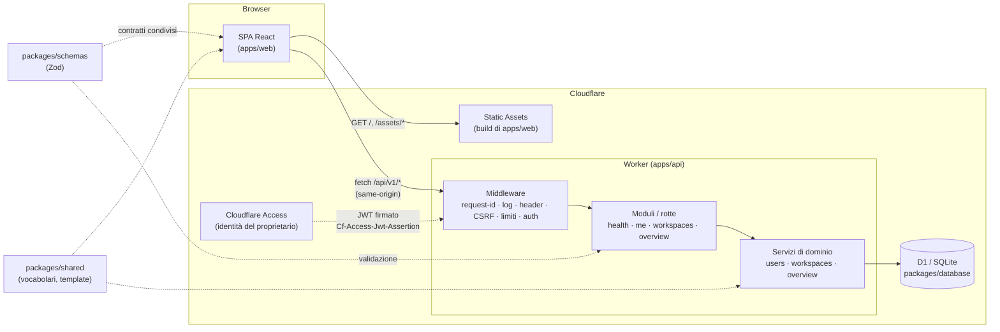

# Architettura — panoramica

Jobward è un **modular monolith** su Cloudflare: un solo Worker serve sia l'API (`/api/*`) sia il
frontend statico, e un solo database D1 contiene i dati. Non ci sono microservizi, code o sistemi distribuiti:
nessuna esigenza attuale li giustifica.

## Componenti

Il Worker gestisce soltanto `/api/*` (`run_worker_first`); tutto il resto è servito come asset con SPA fallback.
Frontend e API hanno quindi la **stessa origine**: niente CORS, cookie non condivisi con altri siti.

## Separazione delle responsabilità

| Responsabilità     | Dove vive                                       | Regola                                                                             |
| ------------------ | ----------------------------------------------- | ---------------------------------------------------------------------------------- |
| Interfaccia        | `apps/web/src/{components,layouts,routes}`      | Nessuna logica di dominio; usa token semantici                                     |
| Stato applicativo  | TanStack Query (stato del server), React (UI)   | Nessuno store globale: il server è la fonte di verità                              |
| Validazione        | `packages/schemas` (Zod)                        | **Un solo schema** per client e server; le risposte sono validate anche dal client |
| Servizi di dominio | `apps/api/src/services`                         | Nessuna dipendenza da Hono; ricevono `db` e `workspaceId` espliciti                |
| API                | `apps/api/src/modules`                          | Parsing, validazione, chiamata al servizio, serializzazione                        |
| Persistenza        | `packages/database`                             | Schema Drizzle + migrazioni; vincoli CHECK/FK a livello DB                         |
| Autorizzazioni     | `middleware/auth.ts` + `services/workspaces.ts` | Identità nel middleware; **ownership** in `requireMembership` (punto unico)        |

## Flusso di una richiesta

1. `requestId` assegna un id di correlazione (`x-request-id`); `requestLogger` registra metodo, percorso, status, durata — mai header, cookie o body.
2. `apiSecurityHeaders` aggiunge header di sicurezza e `Cache-Control: no-store`.
3. `csrfGuard` (solo metodi che modificano dati): `Content-Type: application/json`, `Origin` e `Sec-Fetch-Site` coerenti.
4. `payloadLimit`: massimo 64 KiB.
5. `authenticate`: verifica l'identità e risolve/crea l'utente. Qualsiasi configurazione incoerente → errore (fail-closed).
6. Il modulo valida l'input con Zod, verifica l'appartenenza al workspace e chiama il servizio.
7. Errori → corpo standard `{ error: { code, message, requestId, issues? } }`; gli errori imprevisti non espongono dettagli.

## Contratto API

Prefisso `/api/v1`. Risorsa pubblica: `GET /api/health`.

| Endpoint                                                                             | Stato M0 | Note                                                                                     |
| ------------------------------------------------------------------------------------ | -------- | ---------------------------------------------------------------------------------------- |
| `GET /api/health`                                                                    | ✅       | Pubblica, senza DB                                                                       |
| `GET /api/v1/me`                                                                     | ✅       | Utente + workspace. _Aggiunta rispetto alla proposta iniziale_: serve al gate di accesso |
| `GET /api/v1/workspaces`                                                             | ✅       | Workspace di cui l'utente è membro                                                       |
| `POST /api/v1/workspaces`                                                            | ✅       | 201; **409** se l'utente ha già un workspace (limite MVP, applicato atomicamente)        |
| `GET /api/v1/overview?workspaceId`                                                   | ✅       | Variazione: il workspace è un parametro di query validato e verificato server-side       |
| `boards`, `columns`, `cards`, `move`, `custom-fields`, `labels`, `tasks`, `activity` | ⏳ M1–M3 | Modello REST previsto; vedi roadmap                                                      |

Convenzioni per le prossime risorse: collezioni sotto il workspace tramite `workspaceId` verificato da
`requireMembership`; `PATCH` per modifiche parziali; paginazione a cursore (`?limit&cursor`) per collezioni
estese; `POST /cards/:id/move` come azione esplicita (non un `PATCH` della posizione) perché coinvolge più righe.

Codici d'errore stabili (`packages/shared/src/errors.ts`): `validation_error` 400 · `unauthenticated` 401 ·
`forbidden` 403 · `csrf_rejected` 403 · `not_found` 404 · `conflict` 409 · `payload_too_large` 413 ·
`unsupported_media_type` 415 · `rate_limited` 429 · `auth_misconfigured`/`internal_error` 500.

## Integrazione Cloudflare

- **Workers + Static Assets**: un deploy, una origine. `wrangler.jsonc` definisce due ambienti: default = produzione (fail-closed), `dev` = locale.
- **D1**: binding `DB`; migrazioni in `packages/database/migrations` applicate con `wrangler d1 migrations apply`.
- **Access**: protegge l'intero hostname (pagine e API); il Worker **ri-verifica** comunque il JWT.
- **R2**: previsto in una milestone successiva per gli allegati (non configurato in M0).
- **Limiti di D1 da tenere presenti**: nessuna transazione interattiva (leggi-modifica-scrivi); si usano istruzioni singole atomiche o `batch()` transazionali con condizioni nel SQL. Vedi ADR-0004.

## Strategia di test

| Livello          | Strumento                                                         | Cosa copre                                                                             |
| ---------------- | ----------------------------------------------------------------- | -------------------------------------------------------------------------------------- |
| Unit             | Vitest (node)                                                     | Schemi Zod, campi personalizzati, template, serializzazione                            |
| Integrazione API | Vitest nel runtime Workers (Miniflare)                            | Middleware, auth, CSRF, ownership, servizi su D1 con **le migrazioni reali**           |
| Componenti       | Vitest + React Testing Library (jsdom)                            | Gate, onboarding, shell, navigazione, tema, stati vuoti, client API                    |
| E2E (anteprima)  | Playwright sulla **build di produzione** servita da Static Assets | Header e CSP reali, fallback SPA, instradamento `/api/*`, zero violazioni CSP nell'app |
| E2E              | Playwright + axe su stack reale                                   | Flussi utente, persistenza dopo refresh, mobile, WCAG automatica, protezioni API       |
| Contrasto        | `scripts/check-contrast.mjs`                                      | Rapporti WCAG di ogni coppia di token, chiaro e scuro                                  |

Quality gate: typecheck, lint (0 warning), format, contrasto, `check:config` (invarianti Cloudflare), `db:check` (deriva schema↔migrazioni), test, build, E2E, anteprima. Vedi `.github/workflows/ci.yml`. Esiti verificati in [M0.H](../m0h/testing-report.md).
