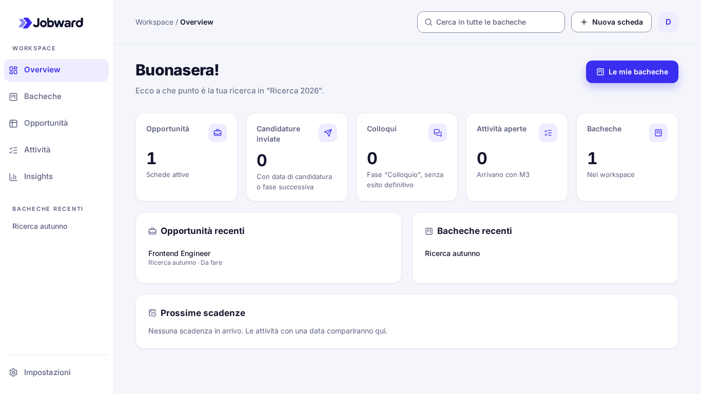
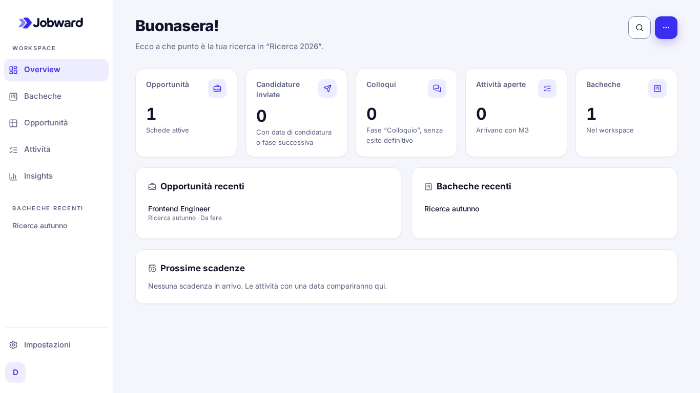
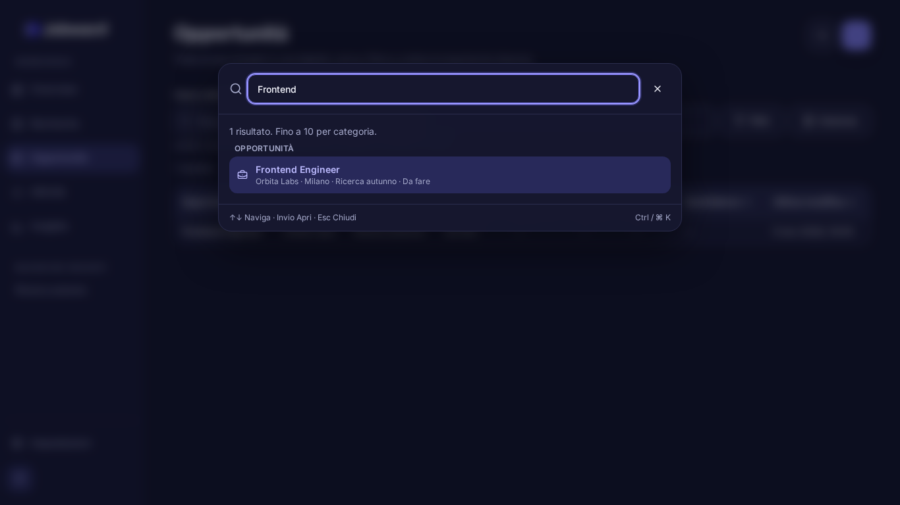

# M3.UI.1 — Confronto visivo

Le cartelle [before](before/) e [after](after/) contengono catture reali Chromium, con dati sintetici creati tramite API locale: workspace «Ricerca 2026», bacheca «Ricerca autunno», una scheda «Frontend Engineer», Orbita Labs, Milano. Nessun dato utente.

Baseline dalla base M3 `f78107c`, in una copia temporanea; «after» dal checkout UI.1. Stessi viewport, locale, fuso, font e dataset. Le catture Glass iniziali sono state sostituite dal confronto sulla base corrente confermata dall’utente. I tempi di aggiornamento sono reali: non è una comparazione pixel con clock congelato.

60 immagini per fase: sei viste (incluso sia elenco sia dettaglio Bacheche), due temi e cinque viewport: 1920×1080, 1366×768, 768×1024, 390×844, 320×568. Quattro ulteriori immagini mostrano ricerca popolata e menu aperto in entrambi i temi.

## Cinque viste, laptop in light mode

| Vista            | Prima                                          | Dopo                                         |
| ---------------- | ---------------------------------------------- | -------------------------------------------- |
| Overview         | [Prima](before/overview-light-1366x768.png)    | [Dopo](after/overview-light-1366x768.png)    |
| Bacheche         | [Prima](before/bacheche-light-1366x768.png)    | [Dopo](after/bacheche-light-1366x768.png)    |
| Opportunità      | [Prima](before/opportunita-light-1366x768.png) | [Dopo](after/opportunita-light-1366x768.png) |
| Attività         | [Prima](before/attivita-light-1366x768.png)    | [Dopo](after/attivita-light-1366x768.png)    |
| Insights         | [Prima](before/insights-light-1366x768.png)    | [Dopo](after/insights-light-1366x768.png)    |
| Dettaglio Kanban | [Prima](before/kanban-light-1366x768.png)      | [Dopo](after/kanban-light-1366x768.png)      |





Il titolo e le statistiche di Overview salgono di 86 px, corrispondenti alla navbar desktop eliminata; margini e tipografia del contenuto sono conservati. Search e Actions si allineano al titolo; l’account passa vicino alle Impostazioni. Nessun offset vuoto residuo.

## Mobile in dark mode

| Vista       | Prima 390×844                                | Dopo 390×844                               |
| ----------- | -------------------------------------------- | ------------------------------------------ |
| Overview    | [Prima](before/overview-dark-390x844.png)    | [Dopo](after/overview-dark-390x844.png)    |
| Bacheche    | [Prima](before/bacheche-dark-390x844.png)    | [Dopo](after/bacheche-dark-390x844.png)    |
| Opportunità | [Prima](before/opportunita-dark-390x844.png) | [Dopo](after/opportunita-dark-390x844.png) |
| Attività    | [Prima](before/attivita-dark-390x844.png)    | [Dopo](after/attivita-dark-390x844.png)    |
| Insights    | [Prima](before/insights-dark-390x844.png)    | [Dopo](after/insights-dark-390x844.png)    |

Le immagini a 320×568 sono disponibili nelle stesse cartelle sostituendo il suffisso del viewport. A questa larghezza i pulsanti passano di riga senza sovrapporsi al titolo. Il drawer mobile conserva il comportamento originario; nessuna seconda barra superiore.

## Ricerca e azioni

| Stato                       | Light                                           | Dark                                           |
| --------------------------- | ----------------------------------------------- | ---------------------------------------------- |
| Ricerca con risultato reale | [Apri](after/search-results-light-1366x768.png) | [Apri](after/search-results-dark-1366x768.png) |
| Menu contestuale ancorato   | [Apri](after/actions-light-1366x768.png)        | [Apri](after/actions-dark-1366x768.png)        |



Riproduzione sul checkout UI.1, con database E2E pulito:

```bash
WORKSPACE_VISUAL_EXTRAS=1 WORKSPACE_VISUAL_DIR="$PWD/docs/m3-ui1/after" \
  pnpm --filter @jobward/web exec playwright test workspace-visual
```

L’output è opt-in: il test visuale viene saltato nella suite ordinaria. Non è un’approvazione automatica di pixel; screenshot, allineamento, leggibilità e spaziatura sono stati ispezionati insieme ai controlli di overflow, tastiera e axe.
