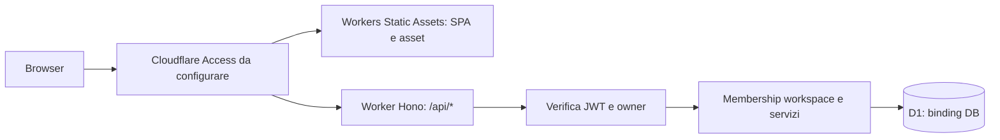

# JOBWARD — M4.0 Private Staging Readiness Audit

Data: 2026-11-09, Europe/Rome. Repository: `lonelyfrank/jobward`.

**Stato corrente M4.0.1: CODE READY — CLOUD INVENTORY PENDING.** Vedere l’aggiornamento e il report collegato sotto.

**Esito storico dell’audit M4.0: M4.0 AUDIT COMPLETE — BLOCKED FOR STAGING PROVISIONING.**

Al termine dell’audit M4.0 il primo provisioning era **NO-GO**. Era stato riprodotto un problema di compatibilità della ricerca con D1; mancavano inoltre la configurazione staging con le relative guardie e l'inventario dell'account. Non viene attribuito lo stato richiesto `READY FOR STAGING PROVISIONING`. M3 resta CODE COMPLETE; **RELEASE READY: no**.

Baseline richiesta: `445d329626b4a900b2cca9cb4a19e09d9c33ec36`. Checkout analizzato: `8071e38251f5529404ffec37fa77355eac7cfb10`. Il checkout differisce dalla baseline soltanto per tre documenti di governance (`docs/m3/m3-t1-readiness.md`, `docs/roadmap/m4-private-release-plan.md`, `docs/roadmap/milestones.md`); codice, migrazioni e configurazione applicativa coincidono. Working tree inizialmente pulito. Non è stato eseguito fetch e non si attesta che questo sia l'ultimo SHA remoto.

Questo incarico aggiunge solo il report. Nessuna modifica al codice applicativo, alle migrazioni, alla configurazione Wrangler attiva, ai segreti, a GitHub o a Cloudflare. Nessun database legacy aperto o modificato. Le prove D1 utilizzano esclusivamente database temporanei locali e dati sintetici. I comandi remoti riportati sotto sono una procedura futura, **non eseguita**.

## Aggiornamento M4.0.1 — hardening pre-staging

La baseline M4.0 resta registrata nelle sezioni A–I sotto. Il seguito implementa soltanto l'hardening necessario, descritto nel [report M4.0.1](m4-0-1-pre-staging-hardening.md); le istruzioni operative aggiornate e i wrapper `staging:*` prevalgono sui comandi diretti storici della sezione G.

- **M40-B01 corretto nel codice:** ricerca letterale con `instr` e `lower` SQL, senza pattern LIKE e senza cambiare il limite di 100 caratteri. Normalizzazione e case-fold preesistenti preservati, nessun nuovo schema o dipendenza. Caratterizzazione API/D1 prima del fix: 8 regressioni fallite su 13; dopo fix: 38 test ricerca D1/workerd verdi.
- **M40-B02 predisposto:** template staging separato con ID vuoti, nessun binding legacy, variabili di sicurezza production/access, URL alternativi e route disabilitati. Guardie su configurazione risolta da Wrangler, UUID/account inventariati, credenziali dedicate, policy owner-only e approvazione legata a SHA/hash/scadenza. 39 test positivi/negativi delle guardie verdi. Dry-run staging riuscito con binding esplicitamente locale, senza credenziali.
- **M40-B03 resta aperto:** inventario Cloudflare reale non effettuato. Nomi, account, UUID, policy Access reali, credenziali e quote non sono stati dichiarati verificati né inventati. Il token e il file di approvazione per le mutazioni non sono stati creati.
- **M40-B04/B05 restano gate remoti:** copertura Access sull'intero Worker, binding D1 live, migrazioni remote, backup/restore, quote CPU Free e smoke dopo provisioning. Nessun deploy o modifica Cloudflare è stato eseguito.
- **Quality gate locali verdi:** `pnpm check`, 1.304 test Vitest, 39 test guardie, 5 test identità, migrazioni/upgrade locali e build default/staging dry-run; E2E finale 237 passati + 1 skip visuale preesistente, zero flaky/retry; preview 14/14. Typecheck/lint ripetuti dopo il fix della fixture Kanban. Primo tentativo E2E interrotto e diagnosi descritti separatamente nel report M4.0.1. Nessun test disabilitato o timeout aumentato; M3S-15 e i flaky preesistenti rimangono aperti/distinti. I due check CI richiesti sulla HEAD della PR restano obbligatori prima del merge.

Stato M4.0.1: **CODE READY — CLOUD INVENTORY PENDING**. Non si dichiara `READY FOR STAGING PROVISIONING` sulla base di questi test.

## A. Architettura attuale verificata

### A.1 Componenti e instradamento

| Elemento            | Evidenza nel repository                                     | Comportamento verificato nel codice                                                                |
| ------------------- | ----------------------------------------------------------- | -------------------------------------------------------------------------------------------------- |
| Monorepo            | `package.json`, `pnpm-workspace.yaml`                       | pnpm 12.15.0; Node richiesto >=22.22.0; cinque package `@jobward/*`                                |
| Worker              | `apps/api/wrangler.jsonc`, `apps/api/src/index.ts`          | Entry ESM `src/index.ts`, export di `createApp()` Hono; compatibility date `2026-10-01`            |
| Backend             | `apps/api/src/app.ts`                                       | Hono, Zod, servizi di dominio; Drizzle su binding D1; niente server Node da avviare in remoto      |
| Frontend            | `apps/web/src/main.tsx`, `app/router.tsx`, `vite.config.ts` | SPA React 19, React Router 8, TanStack Query, Vite 8, Tailwind 4; compilazione in `apps/web/dist`  |
| Asset               | `wrangler.jsonc`, `apps/web/public/_headers`                | Workers Static Assets, binding `ASSETS`, SPA fallback; `_headers` per asset e fallback HTML        |
| API                 | `app.ts`                                                    | `run_worker_first: ["/api/*"]`; le API invocano Hono; gli asset vengono serviti dal router statico |
| Persistenza         | `packages/database/src/index.ts`, `schema.ts`               | `drizzle-orm/d1`, binding obbligatorio **`DB`**; UUID via Web Crypto                               |
| Pacchetti condivisi | `packages/{schemas,shared}`                                 | Contratti Zod, costanti di dominio e limiti condivisi                                              |



Access nel diagramma è l'architettura prevista dal codice, non una risorsa remota verificata. Non esistono backend e frontend su origini separate: `apiRequest()` usa `/api/v1`, `credentials: 'same-origin'`. Il proxy Vite su `localhost:8787` esiste soltanto nello sviluppo locale.

API registrate: `/api/health`; sotto `/api/v1`: `/me`, `/workspaces`, `/overview`, `/opportunities`, `/search`, `/boards`, `/columns`, `/cards`, `/labels`, `/interviews`, `/notes`, `/documents`, `/tasks`, `/custom-fields`, con sottorotte per CRUD, timeline e comandi di dominio. Le rotte sono composte esplicitamente, senza discovery dinamica. `/api/health` è una liveness senza accesso D1 ed è pubblica **nel codice**: in staging anche questa deve essere chiusa da Access. Le rotte dati richiedono autenticazione anche quando il percorso sotto `/api/v1` non è registrato.

### A.2 Autenticazione, utenti, sessioni e workspace

Evidenze: `middleware/auth.ts`, `lib/access.ts`, `middleware/workspace.ts`, `middleware/guards.ts`, `services/users.ts`, `services/workspaces.ts`, `test/auth.test.ts`, `test/security-hardening.test.ts`, suite di ownership/isolation.

1. In modalità `access`, il Worker richiede `Cf-Access-Jwt-Assertion` e verifica firma RS256, issuer `https://<team>.cloudflareaccess.com`, audience e validità temporale tramite `jose.jwtVerify`. Non usa header email o cookie non verificati come identità.
2. Le chiavi provengono da `https://<team>.cloudflareaccess.com/cdn-cgi/access/certs`; risolutore JWKS in cache per isolate, con test di rotazione e indisponibilità. Il dominio team è ristretto da una regex, evitando URL JWKS arbitrari. Errori JWKS/token negano l'accesso.
3. Dopo la verifica, `email.toLowerCase()` deve coincidere con `OWNER_EMAIL.trim().toLowerCase()`. Il proprietario è verificato **prima** di `ensureUser()`: un altro account non deve essere creato nel DB.
4. Configurazione Access assente/incoerente: `500 auth_misconfigured`; token assente/non valido: `401`; altro proprietario: `403`. Questi sono esiti del backend. L'edge Access può fermare la richiesta prima e rispondere con redirect o pagina di diniego.
5. `AUTH_MODE=dev` funziona soltanto con `ENVIRONMENT=development` e hostname di loopback. Non va usato in staging, neppure dietro Access. Un errore di deploy dev non apre le API pubbliche, ma questa guardia non autentica gli asset statici.
6. Non esistono password, endpoint di signup/login, provider OAuth applicativi, callback auth applicative o tabella sessioni. Access gestisce cookie `CF_Authorization`, login, durata e revoca. Il primo GET autenticato può creare l'unica identità ammessa; non è registrazione pubblica.
7. `users`, `workspaces`, `workspace_members` consentono isolamento; MVP: massimo un workspace posseduto, creato con membership owner in batch atomico. `workspaceScope` valida `workspaceId`, richiede membership, impedisce scritture ai viewer; servizi e vincoli DB delimitano le risorse. Workspace altrui/inesistente: stesso `404`. Non si abilitano inviti o multiutenza.

La verifica di `exp` è effettuata se il claim esiste; `lib/access.ts` non imposta `requiredClaims: ['exp']`. I token Access documentati contengono `exp`: questo è un possibile hardening futuro, non una prova che token esterni non firmati siano accettati. Non si sostituisce la verifica JWT con `ctx.access`: Cloudflare documenta una limitazione di propagazione con Static Assets. Il JWT rimane il percorso compatibile con l'app attuale. [Validazione JWT](https://developers.cloudflare.com/cloudflare-one/access-controls/applications/http-apps/authorization-cookie/validating-json/), [Application token](https://developers.cloudflare.com/cloudflare-one/access-controls/applications/http-apps/authorization-cookie/application-token/).

### A.3 Difese che devono restare attive

- CSRF: per richieste mutative JSON obbligatorio, controllo `Origin` quando presente, rifiuto di `Sec-Fetch-Site` cross-origin/same-site; nessuna concessione CORS. Le guardie precedono l'autenticazione: input malformato può ottenere `415`, `403` o `413` prima del `401`.
- Payload massimo 64 KiB, validazione Zod e query parametrizzate. `APP_ORIGIN` amplia le origini ammesse e deve restare **assente in staging**.
- API: `Cache-Control: no-store`, request ID, CSP e header di sicurezza. Asset: CSP da `_headers`, script solo self, niente sourcemap frontend. `style-src 'unsafe-inline'` è un debito già motivato da Radix, non autorizzazione ad aggiungere `unsafe-eval` o script inline.
- Logger applicativo senza query string, body, header, cookie o JWT; gli errori imprevisti registrano tipo e request ID. I log Cloudflare/Access hanno una propria gestione e possono contenere identità/URL: accesso limitato, niente token in URL, evidenze redatte prima del versionamento.
- Nessun WebSocket, EventSource, Durable Object, cron, queue, KV, R2, email o AI nel percorso runtime esaminato. L'unico fetch esterno di autenticazione è il JWKS. I documenti del prodotto sono riferimenti/link, non upload binari da ospitare in R2.

### A.4 Variabili, binding e credenziali

| Nome                                             | Uso                                              | Staging proposto                                              |
| ------------------------------------------------ | ------------------------------------------------ | ------------------------------------------------------------- |
| `DB`                                             | Binding D1 obbligatorio                          | Solo UUID del nuovo `jobward-staging-db`                      |
| `ASSETS`                                         | Workers Static Assets                            | `../web/dist`                                                 |
| `ENVIRONMENT`                                    | Guardia runtime, union TS development/production | **`production`**, anche nell'ambiente Wrangler `staging`      |
| `AUTH_MODE`                                      | Autenticazione                                   | **`access`**                                                  |
| `OWNER_EMAIL`                                    | Unica identità ammessa dal backend               | Valore privato, fuori dai file versionati                     |
| `ACCESS_TEAM_DOMAIN`                             | Issuer/JWKS                                      | Hostname senza schema né slash, `<team>.cloudflareaccess.com` |
| `ACCESS_AUD`                                     | Audience dell'app Access del dominio canonico    | Copiata dall'app corretta, non da un'altra policy/app         |
| `DEV_USER_EMAIL`                                 | Solo sviluppo                                    | Assente                                                       |
| `APP_ORIGIN`                                     | Eccezione CSRF per Vite                          | Assente                                                       |
| `CLOUDFLARE_ACCOUNT_ID` / `CLOUDFLARE_API_TOKEN` | Strumenti operativi                              | Shell/credential store, mai bundle, frontend o git            |

Non occorre una chiave JWT privata o un session secret applicativo: il Worker usa chiavi pubbliche Access. Owner/team/AUD sono configurazione, non credenziali crittografiche; per evitare l'email in git si propone di passarli con `--secrets-file` al futuro deploy. Questa scelta utilizza lo storage protetto delle variabili Workers e richiede autorizzazione nel gate remoto. Nessun valore segreto è stato acquisito nel report o modificato nell'audit.

### A.5 Build, deployment e configurazione esistenti

`pnpm build` compila il web e poi esegue **solo** `wrangler deploy --dry-run --outdir dist --env ""` nel package API. Non è un deploy. Non esiste uno script root di deploy remoto. CI esegue quality e Playwright, senza job di distribuzione. Dev e preview usano D1 locali; `preview` è un ambiente locale, distinto dagli URL preview Cloudflare.

`wrangler.jsonc` default: Worker `jobward`, `workers_dev:false`, `preview_urls:false`, nessuna route, DB `meet-roulette` con UUID tutto zero, Access vars vuote. Non è una configurazione pronta per pubblicare. `scripts/check-config.mjs` impone UUID segnaposto, valori Access vuoti, soli env `dev` e `preview`, entrambi locali; aggiungere `env.staging` direttamente a questo file fa fallire il gate. Le istruzioni storiche che propongono di riempire il default prima del deploy non sono compatibili con l'attuale guardia senza una revisione.

Runtime: Hono/jose usano Web APIs e Web Crypto; Drizzle usa l'adapter D1. Nessun import Node-only nel runtime API/database e nessuna necessità rilevata di `nodejs_compat`. Node è necessario per la toolchain. L'assenza di errori di bundle non prova quota CPU, Access live o validità di UUID remoti.

## B. Blocchi e rischi per il primo deploy

| ID      | Tipo / stato                                             | Problema ed effetto                                                                                                           | Chiusura richiesta                                                                                   |
| ------- | -------------------------------------------------------- | ----------------------------------------------------------------------------------------------------------------------------- | ---------------------------------------------------------------------------------------------------- |
| M40-B01 | **Tecnico, riprodotto**                                  | Ricerche ammesse fino a 100 caratteri diventano pattern `LIKE` oltre il limite D1 di 50 byte; possibile `500` su input valido | Correggere in M4.1 preservando la semantica della ricerca; test di confine su D1/workerd             |
| M40-B02 | **Tecnico/configurazione, aperto**                       | Nessun staging separato e nessuna guardia sui suoi target; default legato a etichetta legacy/segnaposto                       | Config dedicata, guardia account/nome/UUID/env e test di configurazioni pericolose, dry-run staging  |
| M40-B03 | **Precondizione operativa, non verificata**              | Account, piano, quote, Worker/D1/domìni/Access esistenti e disponibilità nomi ignoti                                          | Inventario read-only prima di qualsiasi creazione; nessuna adozione automatica di omonimi            |
| M40-B04 | **Sicurezza/provisioning, aperto**                       | Policy owner-only, dominio canonico, AUD e copertura edge mai verificati                                                      | Procedura privata sotto, Access prima della route; prove senza login, altra email e URL alternativi  |
| M40-B05 | **Validazione operativa, da eseguire dopo provisioning** | D1 remoto, backup/ripristino e CPU Free non misurati                                                                          | Migrazioni su nuovo DB, controlli schema/FK, backup e prova su copia sintetica; smoke/metriche reali |

B05 non richiede di simulare ora un deploy: è un gate per aprire e accettare lo staging dopo l'approvazione. B01 e B02 impediscono già di attestare assenza di blocchi tecnici prima del provisioning.

### B.1 Riproduzione D1 della ricerca

Fonti applicative: `packages/shared/src/constants.ts` (`searchTextMax: 100`), `packages/schemas/src/{search,opportunity}.ts`, `apps/api/src/services/search-text.ts`, `global-search.ts`, `opportunities.ts`. `literalPattern(term)` e `likePattern(term)` aggiungono `%` a entrambi i lati ed effettuano escaping di `\\`, `%`, `_`. Il limite deve riguardare i **byte UTF-8 del pattern finale**, non il numero di caratteri dell'input. Cloudflare specifica 50 byte per LIKE/GLOB. [Limiti D1](https://developers.cloudflare.com/d1/platform/limits/).

Prova con Wrangler 4.157.0, compatibility date `2026-10-01`, configurazione temporanea con `database_id=local-m40-probe`, ogni comando con `--local` e `--persist-to` in `/tmp`; nessun asset né binding legacy:

| Termine           | Byte del pattern `%termine%` | Esito D1 locale                                  |
| ----------------- | ---------------------------- | ------------------------------------------------ |
| 48 `a` ASCII      | 50                           | Successo, risultato `matched: 0`                 |
| 49 `a` ASCII      | 51                           | `LIKE or GLOB pattern too complex: SQLITE_ERROR` |
| 100 `a` ASCII     | 102                          | Stesso errore                                    |
| 17 caratteri `界` | 53                           | Stesso errore                                    |

Query minima equivalente, eseguibile solo sulla config locale temporanea:

```sql
SELECT 'x' LIKE ('%' || printf('%049d', 0) || '%') AS matched;
```

Questa prova riproduce l'errore del motore, non un HTTP 500 remoto osservato. L'app passa i pattern a D1 senza controllo dei byte e gli errori SQL imprevisti diventano `500 internal_error`; l'effetto HTTP deriva dall'analisi del percorso applicativo. I test esistenti controllano il rifiuto a 101 caratteri, ma non chiudono questa frontiera.

Piano minimo: mantenere il contratto di ricerca letterale e la normalizzazione. Valutare confronto con `instr` sul testo normalizzato al posto di LIKE per i percorsi interessati; verificare risultati equivalenti, escaping, accenti, case, AND fra termini, Unicode e costi. In alternativa servirebbe una decisione esplicita sul contratto di lunghezza con validazione coerente API/UI. Non tagliare silenziosamente il termine e non raccomandare un piano Paid: il limite SQL non è risolto acquistando Workers Paid. Nessuna soluzione è implementata in M4.0.

### B.2 Rischi residui ereditati

Il registro M3 conserva M3S-12 (due advisory moderati della toolchain dev), M3S-14 (browser/device/accessibilità aggiuntivi), M3S-15 (tastiera/zoom). Non è stato rieseguito un audit dipendenze remoto né dichiarata la loro chiusura. Mancano rate limiting applicativo e misure CPU live. Per lo staging di un solo owner, Access chiuso, dataset piccolo e quote monitorate sono la base; non si rende una regola WAF a pagamento un prerequisito implicito. Gli altri gate di release restano separati da M4.0.

## C. Architettura proposta per staging privato

| Risorsa             | Proposta                             | Isolamento / controllo                                                                 |
| ------------------- | ------------------------------------ | -------------------------------------------------------------------------------------- |
| Ambiente Wrangler   | `staging`                            | Config separata dal default e da dev/preview                                           |
| Worker              | `jobward-staging`                    | Dedicato; nessun deploy su `jobward` o nomi legacy                                     |
| D1                  | `jobward-staging-db`                 | Nuovo UUID remoto; binding applicativo resta `DB`                                      |
| URL canonico        | `jobward-staging.<zona-controllata>` | Custom Domain HTTPS, intero hostname sotto Access                                      |
| App Access primaria | `jobward-staging-web`                | Self-hosted sull'intero hostname, una sola email                                       |
| Access del Worker   | `jobward-staging-worker`             | Destinazione Worker, All traffic; stessa singola email                                 |
| URL Workers/preview | Disabilitati                         | `workers_dev:false`, `preview_urls:false`, niente Workers Previews o Builds automatici |
| Dati                | Solo sintetici                       | Nessun import, copia o seed da DB locale/legacy/production                             |

Nomi **proposti**, non verificati nell'account. Se un nome è occupato, fermarsi e identificare proprietario, UUID, route e bindings; non sovrascrivere, cancellare o riutilizzare. Dopo verifica si sceglie un suffisso esplicito e si aggiorna l'intero manifest e l'approvazione. Non presumere che il nome diverso basti: gli UUID devono essere diversi da ogni DB legacy/production.

ADR-0014 impone di preservare le risorse persistenti. Il repository conserva `meet-roulette`, `meet-roulette-local`, `meet-roulette-preview`, l'identità dev `dev@meet-roulette.local`, i nomi Jobward già configurati e `DB`/`MIGRATION_DB` test. Queste sono evidenze di configurazione; non provano che esistano omonimi remoti. Non rinominare risorse, cambiare l'email dev, migrare dati, eseguire export legacy o sostituire UUID esistenti. Anche eventuali Worker remoti `meet-roulette*` vanno inclusi nell'inventario, senza modificarli. [ADR-0014](../architecture/decisions/0014-jobward-technical-rebranding.md).

Il primo deploy avviene **senza route**, con entrambi gli URL alternativi disabilitati. Si configura poi Access del solo nuovo Worker e si pubblica il dominio soltanto quando la policy dell'hostname è già attiva e verificata. Non si usa Protect all Workers a livello account: inciderebbe sulle risorse legacy. Nessun Service Binding al nuovo Worker, dispatch namespace, trigger remoto o altra via di invocazione viene configurato.

Per “nessun dato reale” si intendono candidature, aziende, contatti, note e documenti sintetici. Il login reale implica che Access e `users.email` conoscano l'identità del proprietario: è l'unico dato identificativo necessario, conservato in Cloudflare e fuori da git. Non importare CV, URL personali, offerte reali o dump di sviluppo.

### C.1 Modello di configurazione da implementare in M4.1

È una **proposta nel report**, non un file Wrangler attivo. M4.1 deve creare un template e materializzare una copia privata `apps/api/.env.staging.wrangler.json`, ignorata dall'attuale pattern `.env.*`. I percorsi relativi qui sotto presuppongono quella cartella. Nessuna ereditarietà dal file `wrangler.jsonc` legacy.

```json
{
  "$schema": "node_modules/wrangler/config-schema.json",
  "name": "jobward-staging-unconfigured",
  "main": "src/index.ts",
  "account_id": "<ACCOUNT_ID_VERIFICATO>",
  "compatibility_date": "2026-10-01",
  "workers_dev": false,
  "preview_urls": false,
  "routes": [],
  "observability": { "enabled": true },
  "assets": {
    "directory": "../web/dist",
    "binding": "ASSETS",
    "not_found_handling": "single-page-application",
    "run_worker_first": ["/api/*"]
  },
  "env": {
    "staging": {
      "name": "jobward-staging",
      "workers_dev": false,
      "preview_urls": false,
      "routes": [],
      "vars": { "ENVIRONMENT": "production", "AUTH_MODE": "access" },
      "d1_databases": [
        {
          "binding": "DB",
          "database_name": "jobward-staging-db",
          "database_id": "00000000-0000-0000-0000-000000000000",
          "migrations_dir": "../../packages/database/migrations"
        }
      ]
    }
  }
}
```

Fase iniziale: UUID zero, route vuote; questo template consente solo preparazione locale e creazione esplicita del nuovo DB dopo il gate. Dopo la creazione si sostituisce **solo** l'UUID staging con quello appena restituito. Owner/team/AUD non sono `vars` vuote in questo template: saranno caricati con file JSON privato al deploy, evitando conflitto fra una var vuota e un secret omonimo.

Per pubblicare si aggiunge soltanto a `env.staging.routes`, dopo il gate Access:

```json
[{ "pattern": "jobward-staging.<zona-controllata>", "custom_domain": true }]
```

`ENVIRONMENT=staging` non è compatibile con l'attuale tipo TS e non è necessario: il nome ambiente è Wrangler, la modalità di sicurezza runtime è production. Non impostare `remote:true`, `preview_database_id`, `DEV_USER_EMAIL` o `APP_ORIGIN`.

M4.1 deve estendere i controlli per il nuovo template/config senza indebolire le invarianti del default, introdurre il controllo dei target prima di comandi remoti e verificare che gli script richiedano sempre `--config` e `--env staging`. La config privata compilata non entra nel format/lint globale; il template versionato resta verificabile. Le configurazioni private vanno validate da una guardia dedicata, non semplicemente escluse dai controlli di sicurezza.

## D. Cloudflare Zero Trust Access

### D.1 Policy e copertura

Configurazione primaria: applicazione **self-hosted** `jobward-staging-web`, hostname canonico intero, campo path vuoto. Una policy **Allow**, Include → **Emails** → unico indirizzo del proprietario, inserito direttamente nella console privata. Default deny per ogni altra identità. Nessun Allow Everyone, email-domain, “tutti i membri dell'account”, Include login method, Bypass, Service Auth o service token. OTP è un metodo di autenticazione, non il criterio di ammissione; IdP con MFA è preferibile se già disponibile, altrimenti OTP sulla singola email è sufficiente per il primo staging. Durata iniziale proposta: 1 ora. Cookie Secure/HttpOnly, SameSite compatibile con il login Access; non forzare Strict senza prova del flusso. [Policy Access e combinazione delle regole](https://developers.cloudflare.com/cloudflare-one/access-controls/policies/), [cookie Access](https://developers.cloudflare.com/cloudflare-one/access-controls/applications/http-apps/authorization-cookie/).

Proteggere anche favicon, JS, CSS, immagini, deep link, `/api/health`, `/api/v1/*`, percorsi inesistenti e tutti i metodi HTTP. Non creare un'app limitata a `/api/*`. Inventariare app più specifiche per path: potrebbero prevalere o introdurre Bypass.

Difesa aggiuntiva: applicazione Access destinata al **solo Worker `jobward-staging`**, All traffic (produzione e preview), con la stessa policy email esatta. La documentazione attuale supporta questo scope e precisa che anche gli asset rimangono protetti. L'interfaccia rapida propone criteri più ampi: configurarli tramite l'app self-hosted avanzata/API con selector `email`, oppure mantenere il Worker senza route finché il criterio esatto non è disponibile. Non accettare temporaneamente tutto il dominio email per completare il wizard. [Access per Workers](https://developers.cloudflare.com/workers/configuration/cloudflare-access/).

Le applicazioni hostname/path hanno precedenza su quelle Worker; quindi `ACCESS_AUD` del backend deve essere quello dell'app **hostname canonico**, verificando i claim effettivi senza salvarne il token nei log. L'app Worker aggiuntiva può avere un AUD diverso: con URL alternativi disabilitati non è un problema; se una nuova via fosse aperta, l'edge richiederebbe comunque l'owner e il backend rifiuterebbe un AUD inatteso. Non allargare le audience per “far funzionare” un URL alternativo. Se nel collaudo il token sul canonico non è quello atteso, fermarsi e riallineare app/precedenza, senza bypassare la verifica JWT.

La frase storica “Access non protegge workers.dev” in commenti e documenti non è più corretta in generale. La scelta di mantenere URL `workers.dev`, version URLs e preview disabilitati resta valida. **Protezione e disabilitazione sono controlli distinti**; non si abilitano preview per provarli. Verificare anche vecchi alias/version URL, eventuali Custom Domains aggiuntivi, route wildcard e integrazioni Builds/Previews. [workers.dev](https://developers.cloudflare.com/workers/configuration/routing/workers-dev/), [Version URLs](https://developers.cloudflare.com/workers/versions-and-deployments/version-urls/).

### D.2 Compatibilità e gestione sessioni

Non risultano WebSocket nell'applicazione. Access a livello Worker attualmente rifiuta gli upgrade WebSocket con `403`; se in futuro saranno introdotti servirà una decisione di architettura e una protezione hostname verificata. Il WebSocket HMR di Vite è soltanto locale e non entra nella build distribuita.

Non ci sono callback OAuth applicative da rendere pubbliche. Login, callback e logout sotto `/cdn-cgi/access/*` sono gestiti da Cloudflare, senza eccezioni di bypass nell'app. Evitare wildcard che intercettino altri servizi o regole di redirect/cache che alterino quel percorso. Il frontend deve raggiungere le API dalla stessa origine. JWKS outbound non è bloccato da `connect-src` browser.

Con sessione scaduta, una fetch può incontrare redirect Access e HTML/login oppure un errore di rete/CORS. `apiRequest()` non fa re-login automatico: la UI mostra errore e invita a ricaricare. Verificare login iniziale, refresh di deep link, scadenza a pagina aperta, ritorno dopo login, logout e revoca. Nessuna perdita/scrittura duplicata degli input: dopo timeout controllare lo stato prima di ripetere un comando. La revoca edge non equivale a una denylist JWT nel Worker, che continua a controllare firma/claim; nessun percorso deve consentire di aggirare l'edge con un vecchio JWT.

I test locali con chiavi sintetiche provano il backend, non la policy Zero Trust. Un `403` dell'edge con un'altra email non prova da solo il controllo owner nel Worker; quel controllo è coperto separatamente dai test applicativi e resta attivo.

## E. D1: schema, migrazioni, backup e recupero

### E.1 Sequenza verificata nel repository

| Migrazione                              | Effetto                                                                           | Precauzione                                                                    |
| --------------------------------------- | --------------------------------------------------------------------------------- | ------------------------------------------------------------------------------ |
| `0000_init.sql`                         | Schema iniziale utenti/workspace, board, card, custom fields, label, task, eventi | DB nuovo; nessun seed reale                                                    |
| `0001_tenant_integrity.sql`             | FK composite e trigger tenant; ricrea sette tabelle                               | Guardia rifiuta se una delle sette contiene righe; non importare dati prima    |
| `0002_activity_events_trigger_fix.sql`  | Correzione trigger update per cascata/SET NULL                                    | Resta applicata prima dei rebuild successivi                                   |
| `0003_m2_salary_basis_and_indexes.sql`  | `salary_basis` e indici                                                           | Additiva; niente rebuild distruttivo application_details                       |
| `0004_m25_interviews.sql`               | Colloqui, rebuild controllato eventi e relativi trigger                           | Copia e guardia conteggi prima di DROP                                         |
| `0005_m3_c2_notes_documents_dedupe.sql` | Note/documenti, deduplica/fingerprint, rebuild eventi                             | Guardia di uguaglianza dei dati copiati e ripristino trigger                   |
| `0006_m3_tasks.sql`                     | Nuove colonne/vincoli/indici task; conserva `due_at` legacy                       | Dati preesistenti incompatibili fanno fallire; non correggerli automaticamente |
| `0007_board_background_images.sql`      | `boards.background_image` nullable                                                | Migrazione reale, anche se il file non ha newline finale                       |

Migrazioni storiche immutabili; Drizzle journal/snapshot servono al controllo drift, Wrangler conserva i nomi applicati in **`d1_migrations`**. Non confondere con `__drizzle_migrations`. Non usare `drizzle-kit push`, `db:generate`, SQL concatenato senza registro o `d1 execute` per simulare l'applicazione delle migrazioni.

Wrangler applica solo quelle pendenti in ordine. Se fallisce una migrazione, quella viene annullata, mentre le precedenti riuscite restano applicate: non esiste rollback unico automatico dell'intera catena 0000–0007. Non introdurre `PRAGMA foreign_keys=OFF`; verificare le FK con il comando supportato. [Migrazioni D1](https://developers.cloudflare.com/d1/reference/migrations/), [comandi D1 e gestione errori](https://developers.cloudflare.com/workers/wrangler/commands/d1/).

### E.2 Target sicuro

L'app deve usare `DB`, ma nei comandi amministrativi si usa il **nome `jobward-staging-db`**, config assoluta, `--env staging`, `--remote` esplicito. Prima di ogni scrittura confrontare account ID + nome + UUID con il manifest approvato e con l'output D1 info. Il nome da solo non garantisce il target; un UUID legacy nella config è comunque pericoloso. Se compare `meet-roulette`, `jobward` production, `local-*`, UUID zero o un UUID diverso dal nuovo, fermarsi. Non utilizzare i comandi default riportati nella vecchia documentazione.

Non mettere `remote:true` nelle configurazioni di sviluppo; niente `wrangler dev --remote`, Quick Editor o preview che condividano il DB staging. La separazione dei dati si realizza con risorsa e UUID distinti, non con il solo `--env`.

### E.3 Backup e ripristino

Su D1 nuovo Time Travel è automatico: retention Free **7 giorni**, Paid 30; nessun costo aggiuntivo per la funzionalità di ripristino. Salvare bookmark e timestamp prima di migrazioni/cambi rischiosi, oltre a export SQL prima/dopo; sul DB appena creato potrebbe non esserci ancora un bookmark utile: registrare lo stato vuoto, senza usarlo come motivo per ignorare una presenza inattesa di dati. [Time Travel](https://developers.cloudflare.com/d1/reference/time-travel/), [retention per piano](https://developers.cloudflare.com/d1/platform/limits/).

Export e bookmark non sostituiscono una prova di recupero. Conservare file fuori da git, con permessi 0600, checksum e accesso riservato; cifrare la copia fuori macchina se contiene l'identità owner. Retention proposta per export di staging: 7 giorni, tenere anche il checkpoint dello schema vuoto 0007 finché dura il collaudo. Nessun servizio backup/cloud storage aggiuntivo è richiesto o attivato.

Prima di accettare lo staging, importare un export **sintetico** in una copia D1 locale temporanea e verificare schema, migrazioni, FK, conteggi e riferimenti. Questo prova l'export, non il restore remoto. Per provare davvero Time Travel senza danneggiare staging, serve un DB scratch remoto dedicato e una nuova autorizzazione esplicita; non crearlo come effetto collaterale di M4.0 o dell'approvazione del solo DB staging. In alternativa autorizzare espressamente una prova distruttiva sullo staging ancora privo di dati di dominio, con export precedente e route chiuse. Finché la prova reale non è eseguita, il recupero remoto resta non verificato.

In incidente: bloccare l'edge/rimuovere la route, salvare export/bookmark dello stato corrente, ripristinare un bookmark esatto del **solo** staging approvato, poi controllare schema/registro e usare una versione Worker compatibile. Il restore può perdere scritture successive al checkpoint. Nessun `DROP`, delete DB, reset legacy o ripristino “alla data corrente” come scorciatoia. I comandi sono in G.10.

## F. Costi e limiti gratuiti

Valori consultati il **9 novembre 2026** nelle fonti ufficiali. Sono limiti del piano, non una verifica del piano o del consumo attuale dell'account.

| Servizio            | Free e vincoli rilevanti                                                                                                      | Valutazione per un owner                                                                                                      |
| ------------------- | ----------------------------------------------------------------------------------------------------------------------------- | ----------------------------------------------------------------------------------------------------------------------------- |
| Workers             | 100.000 richieste/giorno, 10 ms CPU/invocazione, memoria 128 MB, 50 subrequest/invocazione, 6 connessioni outbound simultanee | Volume plausibile; CPU JWT/validazioni/serializzazione da misurare, non confondere latenza D1 con CPU                         |
| Bundle / asset      | Bundle Worker 64 MiB non compresso; startup 1 s; 20.000 asset/versione, massimo 25 MiB/file                                   | Build corrente molto più piccola; asset separati dal bundle                                                                   |
| Static Assets       | Richieste dirette agli asset gratuite e illimitate; invocazioni del codice Worker seguono il piano Workers                    | Conservare routing API-first attuale; non spostare tutto nel Worker senza misurazione                                         |
| D1 uso              | 5 milioni righe lette/giorno, 100.000 righe scritte/giorno, 5 GB complessivi/account                                          | Piccolo dataset sintetico plausibile; scan/indici/trigger consumano quota, non contare solo risultati restituiti              |
| D1 dimensioni       | 10 DB/account, massimo 500 MB/DB Free, Time Travel 7 giorni, 50 chiamate query/invocazione                                    | Verificare capacità residua inclusi legacy; un `batch()` conta come singola chiamata per questo limite, non una per statement |
| D1 SQL              | 100 parametri/query, 100 KB SQL, LIKE/GLOB 50 byte, riga 2 MB, query max 30 s                                                 | B01 è un'incompatibilità reale; Paid non corregge il pattern                                                                  |
| Access / Zero Trust | Free fino a 50 utenti, retention standard log fino a 24 h                                                                     | Un owner rientra; registrare evidenze subito e non aprire a un dominio intero                                                 |
| Workers Logs        | Fino al 30 novembre: Free 200.000 eventi/giorno, retention 3 giorni                                                           | Logging attuale potenzialmente più eventi per richiesta; no Logpush                                                           |

Fonti: [limiti Workers](https://developers.cloudflare.com/workers/platform/limits/), [billing Static Assets](https://developers.cloudflare.com/workers/static-assets/billing-and-limitations/), [prezzi D1](https://developers.cloudflare.com/d1/platform/pricing/), [limiti D1](https://developers.cloudflare.com/d1/platform/limits/), [piani Access/Zero Trust](https://www.cloudflare.com/plans/), [prezzi Workers e Logs](https://developers.cloudflare.com/workers/platform/pricing/).

**Conclusione economica condizionata:** architettura compatibile con un primo staging sui piani Free, dopo B01 e con risorse/quote disponibili. Non è garantito che tutti i flussi attuali restino sotto 10 ms CPU: cold start/JWKS, overview, ricerca e board grandi richiedono metriche reali. Le quote sono condivise con altri workload nell'account; nessuna garanzia di budget esclusivo per staging. Sul piano Free, oltre le quote richieste/query possono fallire; non autorizzare upgrade automatici per eliminare gli errori.

Costi possibili solo con scelte/configurazioni da controllare: acquisto/rinnovo del dominio se non già disponibile; IdP opzionale a pagamento; upgrade Workers Paid (minimo **5 USD/mese**, poi uso extra), upgrade Access pay-as-you-go (**7 USD/utente/mese** alla data della verifica), storage/query D1 oltre franchigie Paid, Logpush e servizi aggiunti. Workers Paid include 10 milioni richieste e 30 milioni CPU-ms/mese, poi rispettivamente 0,30 USD/milione e 0,02 USD/milione CPU-ms. D1 Paid: oltre incluso, 0,001 USD/milione righe lette, 1 USD/milione scritte, 0,75 USD/GB-mese. Non sono necessari per il disegno proposto; nessuno viene attivato. [Workers pricing](https://developers.cloudflare.com/workers/platform/pricing/), [D1 pricing](https://developers.cloudflare.com/d1/platform/pricing/), [Access pricing](https://www.cloudflare.com/plans/).

Cloudflare annuncia un cambiamento del pricing Workers Logs dal **1 dicembre 2026**: se provisioning/collaudo slittano, ricontrollare Observability prima di abilitarne opzioni aggiuntive. Nessun Workers Caching, Builds gestito, R2, AI, Browser Isolation, supporto enterprise o WAF premium è incluso nel piano operativo. [Workers Logs: cambiamento annunciato](https://developers.cloudflare.com/workers/platform/pricing/).

## G. Procedura operativa proposta: comandi, verifiche e rollback

**Tutti i comandi remoti in questa sezione sono NON ESEGUITI.** I nomi dei nuovi file/script sotto sono contratti da realizzare in M4.1; non esistono ancora nel checkout M4.0. Non copiare l'intera sezione in una shell: ogni checkpoint ha un arresto esplicito. Non usare `CI=true` per i comandi remoti: Wrangler può saltare i prompt in modalità non interattiva, ma i prompt non sostituiscono il gate.

### G.0 Gate locale e gate di autorizzazione remota

Prima di **qualsiasi modifica remota**, incluse configurazione Zero Trust/IdP, route/DNS, creazione DB, variabili protette, upload di versioni e deploy:

1. M4.1 deve chiudere B01 e B02 con PR/gate secondo la governance corrente; codice candidato identificato da SHA e build verificata.
2. Inventario read-only approvato e completato; account/piano, UUID legacy da escludere, disponibilità nomi, zona e hostname registrati privatamente. Nessun cambiamento richiesto a legacy.
3. Unica email fornita dal proprietario tramite canale privato e confrontata con entrambe le policy/backend; non inserirla nel report o nella PR.
4. Manifest reviewabile con account ID, Worker, nome D1, UUID da creare/poi aggiungere, route canonica, app Access, costi attesi zero, ordine dei comandi, criteri stop e piano rollback.
5. **Approvazione esplicita del proprietario** del manifest e delle mutazioni esatte: DB nuovo, due app Access solo staging, variabili Workers staging, deploy iniziale senza route e successiva pubblicazione controllata. `M4.0 audit` o approvazione del report non equivalgono a questa autorizzazione.

L'approvazione non copre servizi Paid, legacy, produzione, GitHub, DB scratch, nuove preview o ampliamento policy. Se cambia account/target/nome/hostname/scope si aggiorna il manifest e si riapre il gate. Dopo la creazione il nuovo UUID deve essere riconciliato con il manifest prima di migrare; prima della route serve il checkpoint Access G.6.

### G.1 Account e inventario read-only

Console: verificare account corretto, MFA amministratore, piano Workers Free e Zero Trust Free, quote disponibili, zona Cloudflare attiva e HTTPS, hostname senza DNS/route/servizi in uso. Inventariare Workers e relativi Domains & Routes/Access/Builds/Previews, D1, app e policy Access incluse wildcard/path. Non cambiare a livello account le policy delle altre applicazioni. Conservare l'inventario in area ignorata/protetta.

Da root repo, per la futura sessione operativa:

```bash
set -euo pipefail
export WRANGLER_SEND_METRICS=false
export STAGING_CONFIG="$PWD/apps/api/.env.staging.wrangler.json"
export STAGING_AUTH="$PWD/apps/api/.env.staging.auth.json"
export EVIDENCE="$PWD/.env.staging-evidence"
umask 077
mkdir -p "$EVIDENCE"
pnpm --filter @jobward/api exec wrangler whoami
pnpm --filter @jobward/api exec wrangler d1 list --json > "$EVIDENCE/d1-inventory.json"
```

`whoami`/`d1 list` sono letture remote. Se non autenticato, fermarsi: non invocare automaticamente login, cambiare account o generare token. L'operatore prepara credenziali con privilegi minimi: letture per inventario; solo dopo approvazione, edit Workers Scripts/D1 e Access Apps/Policies sul corretto account e gestione del dominio sulla sola zona necessaria. Non inserire un Global API Key in nessuna config. I token D1 possono avere ambito account: la guardia UUID rimane indispensabile.

Inventario Workers con token di lettura già preparato, **facoltativo** rispetto alla console:

```bash
curl --fail-with-body --silent --show-error \
  --header "Authorization: Bearer ${CLOUDFLARE_API_TOKEN:?}" \
  "https://api.cloudflare.com/client/v4/accounts/${CLOUDFLARE_ACCOUNT_ID:?}/workers/scripts" \
  > "$EVIDENCE/workers-inventory.json"
```

Controllare `success`, eventuale paginazione e l'account anche se HTTP è 200. Nessuna query/export dei contenuti legacy è necessaria per creare uno staging vuoto.

### G.2 Preparazione locale dello staging

M4.1 materializza la config C.1 in `$STAGING_CONFIG` e valida file ignorati con `git check-ignore`. Finché non si crea il DB, UUID tutto zero; nessun dato owner nel template. File auth JSON privato con soli `OWNER_EMAIL`, `ACCESS_TEAM_DOMAIN`, `ACCESS_AUD`, compilato dopo aver identificato l'app primaria. Permessi 0600, nessuna stampa nel log. Non caricarlo come asset.

```bash
git rev-parse HEAD
git diff --check
git check-ignore apps/api/.env.staging.wrangler.json apps/api/.env.staging.auth.json
node --version
pnpm --version
pnpm install --frozen-lockfile
pnpm check
pnpm test:e2e
pnpm test:preview
```

`pnpm install` può scaricare dipendenze ma non modifica infrastruttura. Nessun test usa `--remote`; usare solo stati di test temporanei dedicati, preservando `.wrangler/state` dev. Nuove prove M4.1: ricerca 48/49/100 caratteri, `%`, `_`, backslash, Unicode, equivalenza risultati, token valido/errato, config fail closed e assenza binding legacy.

### G.3 Creazione DB — prima scrittura remota, solo dopo G.0

Controllare ancora disponibilità `jobward-staging-db`. Non eseguire se esiste già un omonimo non riconciliato. Proposta di residenza: jurisdiction EU; verificare disponibilità Free nell'account, senza upgrade. Non confondere jurisdiction con semplice location hint.

```bash
pnpm --filter @jobward/api exec wrangler d1 create jobward-staging-db \
  --config "$STAGING_CONFIG" --env staging \
  --jurisdiction eu --no-update-config
```

Il comando è remoto anche senza `--remote`. `--no-update-config` evita riscritture automatiche e selezione implicita del binding. Registrare UUID e account dall'output; copiarlo solo nel binding `DB` di `env.staging`. Nessun cambio al default o alle etichette legacy. Aggiornare e riesaminare manifest/guardia con questo UUID esatto.

### G.4 Binding e preflight del DB appena creato

```bash
pnpm --filter @jobward/api exec wrangler d1 info jobward-staging-db \
  --config "$STAGING_CONFIG" --env staging --json
pnpm --filter @jobward/api exec wrangler d1 execute jobward-staging-db \
  --config "$STAGING_CONFIG" --env staging --remote --json \
  --command "SELECT name,type FROM sqlite_schema WHERE name NOT LIKE 'sqlite_%' ORDER BY type,name;"
```

Consentiti soltanto oggetti interni Cloudflare attesi. Qualsiasi tabella o dato applicativo preesistente interrompe la procedura. La lettura D1 deve riferirsi all'UUID appena creato, non al primo DB chiamato `DB` trovato altrove.

Salvare prima il checkpoint dello stato vuoto, se disponibile:

```bash
pnpm --filter @jobward/api exec wrangler d1 time-travel info jobward-staging-db \
  --config "$STAGING_CONFIG" --env staging --json > "$EVIDENCE/pre-migrations-bookmark.json"
pnpm --filter @jobward/api exec wrangler d1 export jobward-staging-db \
  --config "$STAGING_CONFIG" --env staging --remote --output "$EVIDENCE/pre-migrations.sql"
```

Time Travel non richiede `--remote`: è intrinsecamente remoto. Se l'istanza vuota non ha ancora un bookmark, registrare la limitazione dopo aver verificato il vuoto; non inventare un bookmark o ignorare altri errori.

### G.5 Migrazioni e verifica remota

```bash
pnpm --filter @jobward/api exec wrangler d1 migrations list jobward-staging-db \
  --config "$STAGING_CONFIG" --env staging --remote
pnpm --filter @jobward/api exec wrangler d1 migrations apply jobward-staging-db \
  --config "$STAGING_CONFIG" --env staging --remote
pnpm --filter @jobward/api exec wrangler d1 migrations list jobward-staging-db \
  --config "$STAGING_CONFIG" --env staging --remote
pnpm --filter @jobward/api exec wrangler d1 execute jobward-staging-db \
  --config "$STAGING_CONFIG" --env staging --remote --json \
  --command "SELECT id,name,applied_at FROM d1_migrations ORDER BY id;"
pnpm --filter @jobward/api exec wrangler d1 execute jobward-staging-db \
  --config "$STAGING_CONFIG" --env staging --remote --json \
  --command "PRAGMA foreign_key_check;"
pnpm --filter @jobward/api exec wrangler d1 execute jobward-staging-db \
  --config "$STAGING_CONFIG" --env staging --remote --json \
  --command "PRAGMA table_info('boards'); PRAGMA table_info('tasks'); SELECT name,type FROM sqlite_schema WHERE type IN ('trigger','index') ORDER BY type,name; SELECT count(*) AS users_count FROM users; SELECT count(*) AS workspace_count FROM workspaces; SELECT count(*) AS cards_count FROM cards;"
```

Attesi: otto nomi 0000–0007, nessuna pendente, FK senza righe di violazione, colonne `background_image`, `due_on`, `kind`, `cancelled_at`, `request_fingerprint`, trigger e indici equivalenti alla baseline locale, tabelle di dominio vuote. Non usare `PRAGMA integrity_check` come gate: D1 lo rifiuta, come già documentato nell'audit M3.

Una seconda `migrations apply` può verificare “No migrations to apply”, sempre sul medesimo target approvato; non risottomettere l'SQL grezzo. In caso di fallimento mantenere Worker senza route, salvare stato/log e diagnosticare l'ultima migrazione: niente reset o modifiche alla migrazione storica per proseguire.

```bash
pnpm --filter @jobward/api exec wrangler d1 export jobward-staging-db \
  --config "$STAGING_CONFIG" --env staging --remote --output "$EVIDENCE/schema-0007-empty.sql"
pnpm --filter @jobward/api exec wrangler d1 time-travel info jobward-staging-db \
  --config "$STAGING_CONFIG" --env staging --json > "$EVIDENCE/schema-0007-bookmark.json"
sha256sum "$EVIDENCE/schema-0007-empty.sql" > "$EVIDENCE/schema-0007-empty.sha256"
```

### G.6 Configurazione Access prima di pubblicare

1. Dopo G.0, creare/identificare il team Zero Trust Free. Non cambiare team domain/IdP di applicazioni legacy esistenti. Se bisogna modificare una configurazione condivisa non prevista nel manifest, fermarsi.
2. Creare l'app hostname D.1 sul dominio futuro **prima** di associare quel dominio al Worker. Policy singola email, niente path/bypass, sessione 1 h. Salvare privatamente ID e AUD, controllare con il policy tester owner ammesso / seconda email negata.
3. Se il dominio non è ancora instradato, i test HTTP possono fallire per DNS/TLS: non sono una prova di Access. Servono policy tester e ispezione della configurazione; le prove end-to-end avverranno appena la route è aggiunta. Non creare un origin pubblico di test.
4. Preparare il file `$STAGING_AUTH` con i tre valori della tabella A.4; l'email deve coincidere con quella delle policy. Ispezionare localmente senza copiare il contenuto nelle evidenze versionate.
5. Eseguire build e dry-run dello staging senza route:

```bash
pnpm build
pnpm --filter @jobward/api exec wrangler deploy \
  --config "$STAGING_CONFIG" --env staging --dry-run \
  --outdir dist/staging --no-autoconfig
```

Il dry-run deve mostrare solo Worker staging, nuovo D1 e ASSETS; non deve mostrare identità dev o legacy. Le variabili protette non sono ancora caricate: il bundle senza di esse non autentica, come previsto. La guardia locale deve validare separatamente i nomi presenti nel file auth senza stamparne i valori.

### G.7 Deploy controllato e attivazione della route

Con config ancora `routes: []`, nessun trigger/Service Binding/preview, dopo verifica manifest e dry-run:

```bash
pnpm --filter @jobward/api exec wrangler deploy \
  --config "$STAGING_CONFIG" --env staging --no-autoconfig \
  --secrets-file "$STAGING_AUTH" --message "M4.1 staging bootstrap without routes"
```

Questo è un vero upload/deploy remoto e carica i tre valori nello storage protetto del nuovo Worker; autorizzato soltanto nel futuro gate. Registrare deployment/version ID, SHA e output redatto. Verificare nel dashboard: nessun ingresso HTTP pubblico, `workers.dev` e version URL disabilitati, nessun binding inatteso.

Ora che il Worker esiste, configurare **solo su di esso** Access All traffic con policy owner esatta D.1; verificare app/policy e assenza bypass tramite Zero Trust. Non abilitare protezione globale dell'account. Conservare l'app hostname primaria già preparata e il suo AUD nel backend.

**Checkpoint prima della route:** hostname app attiva, policy tester positivo/negativo corretto; Worker app All traffic owner-only; UUID/vars corretti; URL alternativi spenti. Se manca una condizione, lasciare il Worker senza route. Il semplice fatto che `/api/v1/me` sia fail closed non basta: gli asset non attraversano quel middleware.

Solo adesso materializzare in `env.staging.routes` il Custom Domain C.1, rifare guardia/dry-run e poi:

```bash
pnpm --filter @jobward/api exec wrangler deploy \
  --config "$STAGING_CONFIG" --env staging --dry-run \
  --outdir dist/staging --no-autoconfig
pnpm --filter @jobward/api exec wrangler deploy \
  --config "$STAGING_CONFIG" --env staging --no-autoconfig \
  --secrets-file "$STAGING_AUTH" --message "M4.1 staging protected custom domain"
```

Attendere DNS/certificato senza disabilitare Access. Non esiste una finestra intenzionale di app pubblica: il bootstrap non ha ingressi e il dominio è protetto prima della route. Eventuali collisioni DNS/certificato interrompono la procedura; non cancellare record o servizi esistenti per liberare il nome.

### G.8 Verifica accessi autorizzati, non autorizzati e ingressi alternativi

Valorizzare `STAGING_HOST` con il dominio reale, fuori da git. Prima prova senza cookie e senza `-L`, per distinguere redirect Access da contenuto dell'app:

```bash
curl --silent --show-error --dump-header - --output /dev/null "https://${STAGING_HOST:?}/"
curl --silent --show-error --dump-header - --output /dev/null "https://${STAGING_HOST:?}/boards"
curl --silent --show-error --dump-header - --output /dev/null "https://${STAGING_HOST:?}/api/health"
curl --silent --show-error --dump-header - --output /dev/null "https://${STAGING_HOST:?}/api/v1/me"
curl --silent --show-error --dump-header - --output /dev/null \
  --header 'Cf-Access-Jwt-Assertion: invalid.invalid.invalid' \
  "https://${STAGING_HOST:?}/api/v1/me"
```

Attesi: challenge/redirect Access o diniego, **mai** HTML Jobward, JSON health/me o JS/CSS privi di autenticazione. Testare anche URL di un vero asset dal manifest build, favicon e immagine background. Un 200 della pagina login dopo redirect non è successo applicativo. Un 404 su un asset inventato non dimostra che gli asset reali siano privati.

Browser incognito: altra email → diniego, nessun nuovo utente nel DB; owner → login, `/api/v1/me` JSON 200 con identità attesa. Mai allargare la policy per generare il test negativo del backend; usare i test sintetici per 403 owner mismatch. Verificare API diretta con sessione owner, refresh deep link, CSP/header reali, nessun CORS permissivo.

Enumerare dal dashboard tutti gli host effettivi. Sul Workers subdomain reale provare `jobward-staging.<subdomain>.workers.dev` e gli eventuali alias/version URL **già esistenti**: devono essere disabilitati/non servire l'app. Provare eventuali altri domini/route scoperti: nessun contenuto anonimo. Non creare una preview né riabilitare una URL per poterla testare. Se esiste un ingresso inatteso, non accettare il collaudo e chiudere la route canonica mantenendo Access.

### G.9 Smoke applicativo e backup verificabile

Usare solo nomi `STAGING-M41-*`, aziende inventate, URL `example.com`, note fittizie. L'email owner proviene esclusivamente dall'identità Access.

| Scenario          | Evidenza richiesta                                                                                                                              |
| ----------------- | ----------------------------------------------------------------------------------------------------------------------------------------------- |
| Primo login       | Un solo utente owner, nessun workspace; onboarding crea un solo workspace e membership owner, timezone Europe/Rome                              |
| Board             | Creazione da template, colonne, ordinamento, preferito, sfondo persistente dopo refresh                                                         |
| Scheda            | Creazione/modifica, cambio colonna, stage/outcome, archiviazione/ripristino; persistenza al secondo caricamento                                 |
| Ricerca           | Globale e Opportunità, termini normali e confini B01 dopo fix, literal `%`/`_`/backslash/Unicode, niente 500                                    |
| Colloqui          | Crea/riprogramma/completa, cronologia e retry idempotente coerenti                                                                              |
| Note/documenti    | CRUD consentito, link sintetico, nessun upload/collegamento a storage reale                                                                     |
| Task              | Crea, scadenza, completa/riapri/annulla, contatori overview e attività concordanti                                                              |
| Sicurezza backend | Con cookie owner: workspace inesistente/altro ID → 404; POST cross-origin → 403; Content-Type errato → 415; payload >64 KiB → 413; API no-store |
| Sessione          | Scadenza, reload/re-login, logout e revoca in Zero Trust; nessun accesso successivo tramite URL alternativo                                     |
| Risorse           | Errori 1102/limiti query assenti nei flussi, CPU misurata cold/warm e volumi D1/log entro Free; riportare i valori effettivi                    |

Le prove d'isolamento con due owner/workspace restano nei test locali: non aprire Access a un secondo utente per il collaudo. Uno stato vuoto corretto non equivale a una prova con dati sintetici persistiti. Prima di revocare la sessione per l'ultimo test salvare il lavoro; non copiare cookie/JWT nel report, trace, terminal history o git.

Esportare poi il dataset sintetico e provarne il recupero locale:

```bash
pnpm --filter @jobward/api exec wrangler d1 export jobward-staging-db \
  --config "$STAGING_CONFIG" --env staging --remote --output "$EVIDENCE/post-smoke.sql"
sha256sum "$EVIDENCE/post-smoke.sql" > "$EVIDENCE/post-smoke.sha256"
pnpm --filter @jobward/api exec wrangler d1 time-travel info jobward-staging-db \
  --config "$STAGING_CONFIG" --env staging --json > "$EVIDENCE/post-smoke-bookmark.json"
```

Per l'import locale usare **un'altra config temporanea**, mai `$STAGING_CONFIG`, binding `DB`, `database_id=local-m41-restore`, nessun asset, persist dir nuovo. Dopo averla creata in M4.1 e valorizzato `RESTORE_CONFIG`/`RESTORE_STATE` con percorsi assoluti temporanei:

```bash
pnpm --filter @jobward/api exec wrangler d1 execute DB \
  --config "$RESTORE_CONFIG" --local --persist-to "$RESTORE_STATE" --file "$EVIDENCE/post-smoke.sql"
pnpm --filter @jobward/api exec wrangler d1 execute DB \
  --config "$RESTORE_CONFIG" --local --persist-to "$RESTORE_STATE" --json \
  --command "PRAGMA foreign_key_check; SELECT name FROM d1_migrations ORDER BY id; SELECT count(*) AS cards_count FROM cards; SELECT count(*) AS tasks_count FROM tasks;"
```

Non applicare prima le migrazioni a questo DB di ripristino: il dump include lo schema e altrimenti collide. Verificare nel dump la presenza del registro `d1_migrations`; se l'export della versione in uso lo omette, fermarsi e preparare una procedura di riconciliazione esplicita, senza segnare tutte le migrazioni applicate alla cieca. Confrontare anche ID, riferimenti, note/colloqui, eventi e schema, non soltanto conteggi.

### G.10 Rollback e criteri di arresto

Arresto immediato per: account/UUID/nome inatteso, oggetti/dati preesistenti, migrazioni fallite, mismatch AUD, policy più ampia dell'owner, contenuto anonimo su qualunque ingresso, errore di quota persistente, necessità di Paid non approvata. Conservare log redatti e lo stato; non correggere aprendo Access o usando il DB legacy.

**Contenimento:** mantenere entrambe le app Access; disattivare prima il Custom Domain/route del solo staging in Domains & Routes e riportare `env.staging.routes` a `[]` nella config privata per evitare riaperture. Per fermare anche le sessioni valide, policy Block temporanea dedicata allo staging in posizione corretta e revoca delle sessioni, verificando il diniego. Non rimuovere Access per prima e non cambiare policy condivise col legacy. L'operazione di contenimento deve essere inclusa nel gate G.0.

**Worker:** se esiste una versione precedente verificata e compatibile con il DB corrente, registrare prima la lista e poi usare un ID esplicito:

```bash
pnpm --filter @jobward/api exec wrangler deployments list --config "$STAGING_CONFIG" --env staging
pnpm --filter @jobward/api exec wrangler versions list --config "$STAGING_CONFIG" --env staging
pnpm --filter @jobward/api exec wrangler rollback "${KNOWN_GOOD_VERSION_ID:?}" \
  --config "$STAGING_CONFIG" --env staging --message "M4.1 staging rollback approved"
```

Il rollback del codice non ripristina D1 né garantisce il ripristino di route/policy; controllarli separatamente. Al **primo deploy** non esiste necessariamente una versione buona: lasciare la route rimossa, mantenere DB/export e diagnosticare. Non usare un rollback senza ID che scelga implicitamente la versione precedente.

**Database:** soltanto dopo contenimento e riconferma di account/UUID/checkpoint, con autorizzazione esplicita al ripristino/perdita delle scritture successive. Salvare prima lo stato corrente:

```bash
pnpm --filter @jobward/api exec wrangler d1 export jobward-staging-db \
  --config "$STAGING_CONFIG" --env staging --remote --output "$EVIDENCE/pre-restore.sql"
pnpm --filter @jobward/api exec wrangler d1 time-travel info jobward-staging-db \
  --config "$STAGING_CONFIG" --env staging --json > "$EVIDENCE/pre-restore-bookmark.json"
pnpm --filter @jobward/api exec wrangler d1 time-travel restore jobward-staging-db \
  --config "$STAGING_CONFIG" --env staging --bookmark "${APPROVED_RESTORE_BOOKMARK:?}"
```

`restore` è remoto senza flag `--remote`. Non aggiungere `--yes` non supportato. Conservare anche il bookmark restituito dal restore per poter valutare il recupero dello stato precedente. Ripetere verifiche G.5, controllare allineamento schema/versione, poi rifare le prove Access e gli smoke prima di riaprire la route. Nessuna migrazione “down” automatica, import di dump sopra un DB popolato o cancellazione di risorse rientra in questa procedura.

## H. Checklist di sicurezza e stato delle evidenze

Le caselle aperte richiedono lavoro/evidenza; non indicano operazioni già autorizzate.

- [x] Repository e differenza dalla baseline M3 analizzati; entry, routing, binding e auth verificati nel codice.
- [x] Middleware JWT/owner, membership, CSRF, payload, logging e header individuati; nessun signup pubblico.
- [x] Migrazioni 0000–0007 lette; rischi rebuild/guardie e registro distinti da Drizzle.
- [x] Compatibilità D1 LIKE verificata localmente: difetto B01 confermato.
- [x] ADR-0014 preservata; nessuna lettura dei contenuti o modifica DB legacy.
- [x] Nessuna infrastruttura remota, deploy, migrazione remota, secret o modifica GitHub eseguiti.
- [ ] B01 corretto e coperto con test D1 dei confini e della semantica.
- [ ] Config staging, template e guardie target implementati/verificati; nessuna ereditarietà da legacy.
- [ ] Account/piani/quote e disponibilità nomi verificati in inventario read-only.
- [ ] Email unica privata, hostname controllato, app Access e AUD riconciliati.
- [ ] Gate remoto esplicito sul manifest e sulle sole mutazioni staging.
- [ ] D1 nuovo, UUID distinto, 0000–0007 applicate e verificate in remoto, nessuna tabella/seed legacy.
- [ ] Bootstrap senza ingressi, Access hostname e Worker All traffic attivi prima della route.
- [ ] URL alternativi/version/preview disabilitati; nessun service binding/trigger/canale aggiuntivo.
- [ ] Anonimo e altra email bloccati su pagine, asset, API e health; owner ammesso.
- [ ] Verifica backend indipendente dalla policy edge, CSRF/CORS/payload/ownership attivi.
- [ ] Sessione scaduta/logout/revoca verificati senza perdita di dati o workaround di bypass.
- [ ] Smoke sintetici, quote CPU/D1/log e backup/import su copia verificati.
- [ ] Recupero remoto Time Travel provato con autorizzazione specifica, oppure limite non verificato mantenuto esplicito.
- [ ] Rischi M3 residui aggiornati con prove; nessuna promozione automatica a RELEASE READY.

## I. Piano M4.1 eseguibile dopo approvazione

| Ordine | Attività                                                                       | Criterio di completamento / arresto                                                                                                            |
| ------ | ------------------------------------------------------------------------------ | ---------------------------------------------------------------------------------------------------------------------------------------------- |
| 1      | Fix compatibilità ricerca B01, senza nuove funzionalità                        | Contratti coerenti; prove D1 a 48/49/100 caratteri, Unicode/escaping; nessun 500 da input valido; risultati invariati                          |
| 2      | Config staging separata, template senza PII, validatore e comandi protetti B02 | Default/dev/preview invariati; rifiuto account/UUID/nome/vars/route pericolosi; dry-run staging; nessun DB legacy                              |
| 3      | Aggiornare indicazioni Access obsolete e runbook                               | Distinguere hostname/Worker scope, AUD, WebSocket, Static Assets, URL disabilitati; procedura verificabile                                     |
| 4      | Quality/PR secondo governance                                                  | SHA candidato, `pnpm check`, E2E e preview verdi; PR e integrazione solo se autorizzate separatamente; nessuna modifica diretta GitHub in M4.0 |
| 5      | Inventario read-only e manifest concreto                                       | Account, nomi liberi, zona/hostname, email privata e piano Free; collisione → stop                                                             |
| 6      | **Gate G.0 del proprietario**                                                  | Approvazione esplicita delle modifiche remote concrete; senza approvazione nessun provisioning                                                 |
| 7      | Nuovo D1, binding, 0000–0007 e checkpoint                                      | UUID riconciliato, schema/FK/registro corretti, zero dati reali                                                                                |
| 8      | Access + bootstrap chiuso + pubblicazione protetta                             | Nessuna finestra anonima intenzionale; tutte le prove G.8 positive/negative                                                                    |
| 9      | Smoke, limiti Free, backup e recupero                                          | Dataset sintetico, metriche effettive, export/import verificato e stato reale della prova restore                                              |
| 10     | Report di collaudo e decisione successiva                                      | Deployment ID/SHA, evidenze redatte, blocchi/limiti espliciti; eventuale rollback; nessuna dichiarazione automatica di release                 |

M4.1 qui indica la preparazione e il primo staging, non autorizza Insights, AI, registrazione pubblica, multiutenza, scheduler o altre feature M4/M5. Per raggiungere `READY FOR STAGING PROVISIONING` prima del provisioning servono almeno B01/B02 chiusi, inventario e manifest completi e gate approvato; per accettare lo staging servono poi le verifiche remote. Questa valutazione non anticipa quei risultati.

## Registro delle verifiche eseguite in M4.0

- `git status --short`, `git rev-parse HEAD`, `git log`, `git diff --stat 445d329..HEAD`; lettura diretta dei file applicativi, migrazioni, script, CI, ADR e registri M3.
- Node locale `v22.23.1`, pnpm `12.15.0`, Wrangler `4.157.0`. Help locali di `deploy`, `d1 create`, `d1 time-travel restore`, `rollback` consultati per verificare sintassi e opzioni; nessun comando remoto di questa sezione è stato eseguito.
- Prima esecuzione di `pnpm check` in sandbox: typecheck, lint, formato, contrasto/config/brand e cinque test identità superati; arresto a `db:check` per `spawnSync pnpm EPERM`. Le prove API separate in sandbox non hanno eseguito test per `listen EPERM 127.0.0.1`; non sono fallimenti funzionali né esiti verdi.
- Build separata in sandbox: frontend compilato, 54 asset; bundle Worker **1288,76 KiB**, gzip **229,69 KiB**; dry-run completato. Wrangler ha segnalato impossibilità di scrivere il log nella sua directory esterna alla workspace; la successiva verifica fuori sandbox distingue questo limite dalla build applicativa.
- Riesecuzione locale autorizzata fuori sandbox di `pnpm check`: **PASS, exit 0**. Typecheck, lint, formato, contrasto/config/brand, cinque test identità, drift schema, tutti e tre gli script upgrade/rollback D1, test e build dry-run superati. Suite Vitest: **57 file / 1.291 test** (shared 632, schemas 59, web 172, API 428), nessun fallimento. Upgrade M1→0007, M2.5→0005 con API sullo schema corrente e 0005→0006 con rollback verificati. Bundle e 54 asset confermati fuori sandbox, senza errore di scrittura log. Solo D1 temporanei locali e build dry-run, nessuna operazione Cloudflare remota. Log di sessione: `/tmp/jobward-m40-check-approved.log`. Le suite verdi non includono una regressione sul limite B01.
- `pnpm test:preview` fuori sandbox: **14/14 test Chromium superati** (51,6 s), build reale servita da Workers Static Assets e D1 preview locale isolato. Non è una prova di Access remoto. La suite E2E di sviluppo completa non è stata rieseguita in M4.0.
- Report verificato con Prettier e `git diff --check`; sintassi di 16 blocchi Bash e dei due esempi JSON validata senza eseguire i comandi descritti.
- Quattro query D1 sintetiche fuori sandbox, sempre `--local`: esiti B.1, log temporaneo `/tmp/jobward-m40-d1-probe.log`. Riproduzione aggiuntiva all'audit, nessun test o fix applicativo aggiunto.
- Fonti Cloudflare ufficiali consultate online per Access, JWT, Worker routing/limiti/pricing, Static Assets e D1. Nessun account Cloudflare interrogato o modificato; nessuna disponibilità remota dichiarata.
