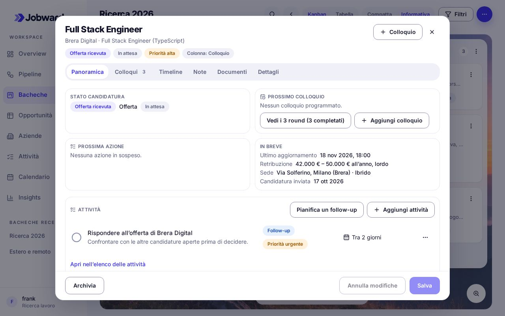
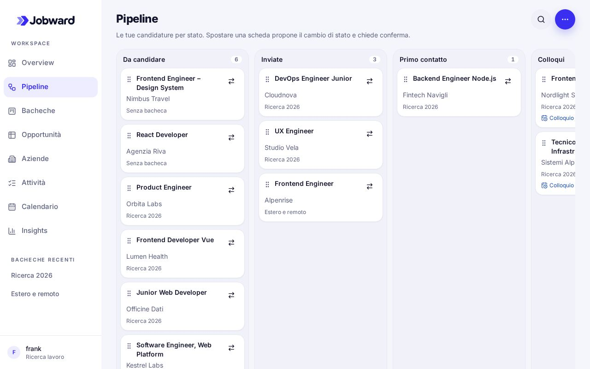
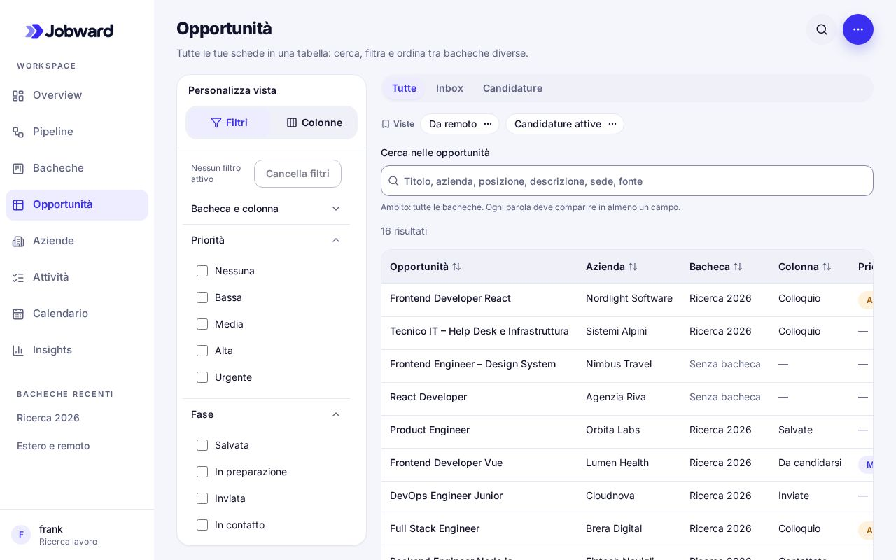
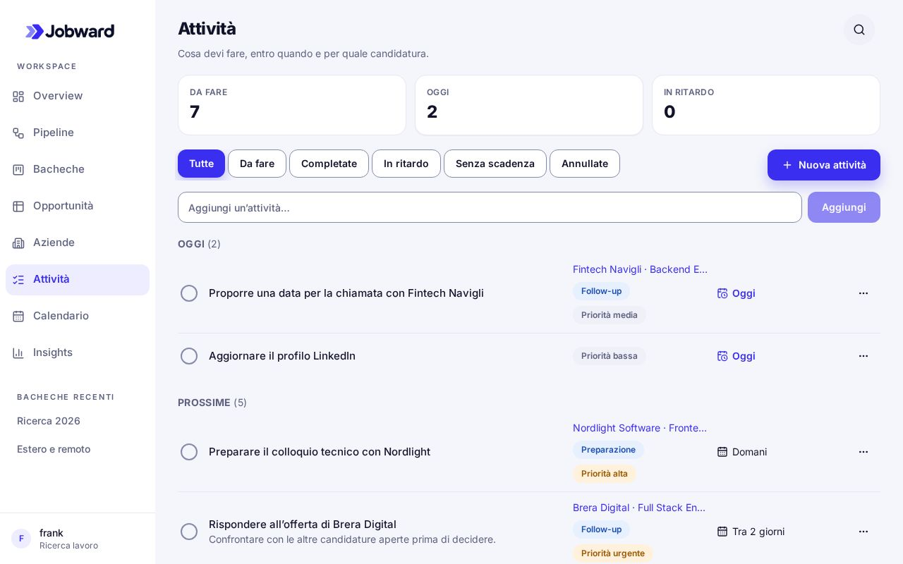
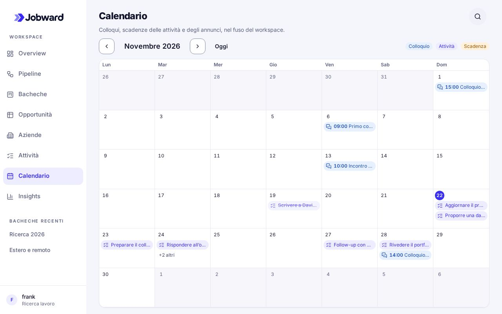
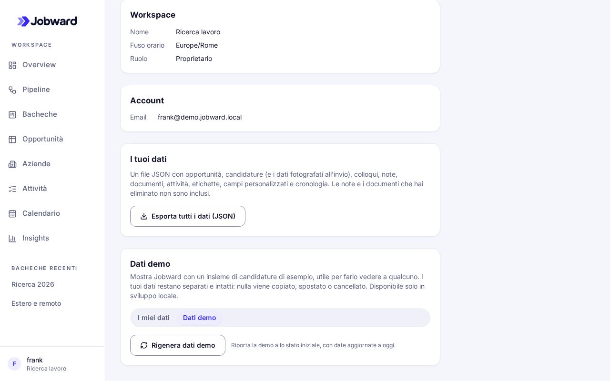

# Usare Jobward

**Stato:** canonico · **Verificato su:** `jobward-v1` `b34c032` (2026-11-22, PID-01). Le etichette tra virgolette sono quelle mostrate dall'interfaccia. Introduzione e installazione: [README](README.md). Le schermate mostrano il profilo **Dati demo** (aziende e persone inventate); si rigenerano con `pnpm docs:screenshots`.

_Overview: il punto della ricerca a colpo d'occhio._

## 1. Salvare un'opportunità

Un'opportunità è un'offerta che ti interessa. Salvarla **non** significa candidarsi.

1. Apri **Azioni della vista** (⋯) in alto e scegli **Nuova opportunità**.
2. La finestra ha quattro passi: **Annuncio · Dettagli · Valutazione · Candidatura**. È obbligatorio solo il **Titolo**; il resto puoi aggiungerlo dopo.
3. Se Jobward trova un'opportunità simile già salvata, te lo segnala («Forse l'hai già salvata:») senza bloccarti.
4. In **Bacheca** puoi scegliere una bacheca oppure **Nessuna bacheca (Inbox)**.
5. All'ultimo passo, «Ti sei già candidato?» ti permette di registrare subito una candidatura già inviata.
6. **Salva opportunità**.

Dentro una bacheca puoi anche usare **Aggiungi scheda** in fondo a una colonna per un inserimento rapido.

I dettagli che puoi registrare: azienda, ruolo, luogo, modalità di lavoro, contratto, retribuzione (con periodo e lordo/netto), fonte e link, data di pubblicazione, livello di esperienza, scadenza, requisiti, benefit, interesse personale da 1 a 5, campi personalizzati della bacheca ed etichette. Ciò che non inserisci resta «non specificato», mai un valore inventato.

## 2. Candidarsi e seguire la candidatura

1. Apri l'opportunità (clic sulla scheda o sulla riga della tabella): si apre il dettaglio con le schede **Panoramica, Colloqui, Timeline, Note, Documenti, Dettagli**.
2. Premi **Candidati**. Jobward crea la candidatura n. 1 e conserva una **fotografia** dei dati dell'annuncio in quel momento.
3. Se una candidatura si è chiusa (per esempio con un rifiuto), puoi ricandidarti con **Nuova candidatura**: la precedente resta nello storico.

_Il dettaglio di un'opportunità, scheda Panoramica._

Lo stato della candidatura cambia **solo** con un'azione esplicita: nella **Pipeline** trascini la scheda o usi **Sposta in…**, e Jobward chiede sempre conferma; chiudendo una candidatura ti chiede «Come si è chiusa?» (assunzione, rifiuto, ritiro, nessuna risposta). Spostare una scheda in una bacheca personale **non** cambia lo stato della candidatura.

_La Pipeline: una colonna per ogni fase della candidatura._

## 3. Colloqui, note e documenti

- **Colloqui:** nella scheda Colloqui usa **Aggiungi colloquio**; ogni round si può **Programmare** o **Riprogrammare** (con fuso orario), completare con un esito e **Aggiungi feedback**, oppure annullare.
- **Note:** testo libero legato all'opportunità.
- **Documenti:** riferimenti (titolo, link, nota) a CV, lettere o portfolio; i file non vengono caricati.
- **Timeline:** la cronologia di eventi, note e attività dell'opportunità.

## 4. Organizzare con le bacheche

- In **Bacheche** crea una bacheca con **Nuova bacheca**, partendo da un modello.
- In una bacheca passi da **Kanban** a **Tabella**. Le schede si spostano con mouse, touch o tastiera.
- Il menu della bacheca offre **Aggiungi colonna**, **Modifica bacheca…** (nome, colore, sfondo), **Campi personalizzati…** ed **Elimina bacheca…**.
- **Archivia** toglie una scheda dalla bacheca senza eliminarla.
- Eliminare una bacheca **non elimina le opportunità**: restano in Opportunità, senza bacheca, con tutto il loro storico.

_Una bacheca in vista Kanban, con lo sfondo scelto._

## 5. Trovare e filtrare: Opportunità, viste salvate, ricerca

- **Opportunità** mostra tutto in tabella, con le schede **Tutte**, **Inbox** (opportunità senza candidatura) e **Candidature**. Usa «Cerca nelle opportunità», **Filtri** e **Colonne**; filtri e ordinamento restano nell'indirizzo della pagina.
- **Viste salvate:** con **Salva vista** conservi la combinazione corrente di filtri; ogni vista si può aggiornare («Aggiorna con i filtri attuali»), rinominare o eliminare. Le viste salvate esistono solo in Opportunità.
- **Cerca in Jobward** (Ctrl/Cmd+K) cerca tra opportunità, bacheche e colloqui.
- **Aziende** elenca le aziende; il dettaglio mostra «Informazioni» e «Opportunità e candidature».

_Opportunità: filtri, viste salvate e tabella._

## 6. Attività e scadenze

- In **Attività** scrivi in «Aggiungi un'attività…»; le viste sono Tutte, Da fare, Completate, In ritardo, Senza scadenza, Annullate.
- Un'attività può essere legata a un'opportunità o generale; la scadenza è una data.
- Le attività non si eliminano: si **completano** o si **annullano**, e si possono riaprire.
- Nel dettaglio di un'opportunità Jobward può **suggerire** un follow-up in base a regole dichiarate; il suggerimento non viene mai applicato da solo.

_La pagina Attività._

## 7. Calendario e Insights

- **Calendario:** griglia mensile (agenda sul telefono) con **Mese precedente**, **Mese successivo** e **Oggi**; legenda Colloquio / Attività / Scadenza.
- **Insights:** indicatori (opportunità, Inbox, candidature, colloqui, offerte, risposta mediana), funnel delle candidature, stato attuale, tempi di risposta, candidature per settimana, esiti, fonti e modalità di lavoro. I dati mancanti sono dichiarati; nessun numero è stimato senza dirlo.

_Il Calendario del mese._

_Insights: numeri calcolati dai dati, con i limiti dichiarati._

## 8. Impostazioni ed esportazione

In **Impostazioni** trovi: **Etichette** (creazione e gestione), **Aspetto** (Chiaro, Scuro, Come il sistema), le informazioni di workspace e account (sola lettura) e **I tuoi dati** con **Esporta tutti i dati (JSON)**, che scarica `jobward-export-AAAA-MM-GG.json`. Il file non include ancora aziende e viste salvate.

**Dati demo** (solo nell'app locale): il selettore «I miei dati / Dati demo» passa a un insieme di esempio, utile per una presentazione. È un profilo separato: ciò che fai nella demo non tocca i tuoi dati, e viceversa. Il nome nel menu account diventa «frank» e il workspace «Ricerca lavoro», così sai sempre dove sei. Le aziende italiane della demo hanno sede in quartieri diversi di Milano (campo **Sede**), così puoi confrontarne la distanza da casa. **Rigenera dati demo** riporta la demo allo stato iniziale con date aggiornate a oggi. L'esportazione esporta i dati del profilo attivo.

_Impostazioni → Dati demo._
