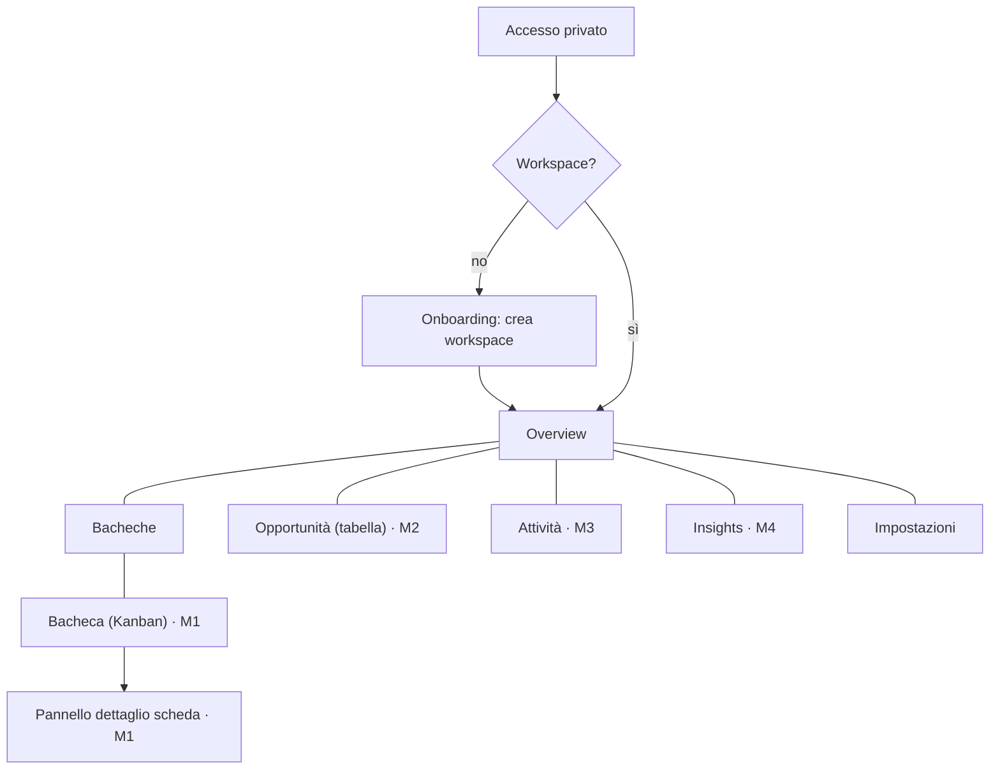

# Architettura dell'informazione

## Layout

- **Sidebar sinistra** (persistente da `md`, comprimibile; drawer su mobile): Overview · Bacheche · Opportunità · Attività · Insights · Impostazioni; sezione "Bacheche recenti" (dati reali).
- **Topbar**: nome della vista attiva · ricerca (_in arrivo, M2_) · creazione rapida (_in arrivo, M1_) · menu utente (email, tema).
- **Main**: contenuto variabile; riceve il focus a ogni navigazione.
- **Pannello di dettaglio**: si affiancherà a `main` in M1 (desktop: laterale; mobile: a schermo intero) per non perdere il contesto della bacheca.

## Rotte

| Percorso           | Schermata                  | Stato                       |
| ------------------ | -------------------------- | --------------------------- |
| `/`                | Overview                   | ✅                          |
| `/boards`          | Elenco bacheche + template | Stato vuoto ✅; funzioni M1 |
| `/boards/:boardId` | Kanban                     | Segnaposto dichiarato (M1)  |
| `/opportunities`   | Tabella                    | Stato vuoto, M2             |
| `/tasks`           | Attività                   | Stato vuoto, M3             |
| `/insights`        | Statistiche                | Stato vuoto, M4             |
| `/settings`        | Impostazioni               | ✅ tema, workspace, account |
| `*`                | 404 dentro la shell        | ✅                          |

L'accesso senza workspace mostra l'onboarding al posto della shell; l'accesso non autorizzato mostra una schermata dedicata.

## Responsive

| Larghezza       | Comportamento                                                                                                   |
| --------------- | --------------------------------------------------------------------------------------------------------------- |
| ≥ 768 px (`md`) | Sidebar persistente (256 px) comprimibile a 64 px con tooltip; scelta ricordata                                 |
| < 768 px        | Sidebar → drawer (focus trap, Esc, overlay); pulsanti e righe di menu ≥ 44 px; ricerca nascosta (arriva con M2) |
